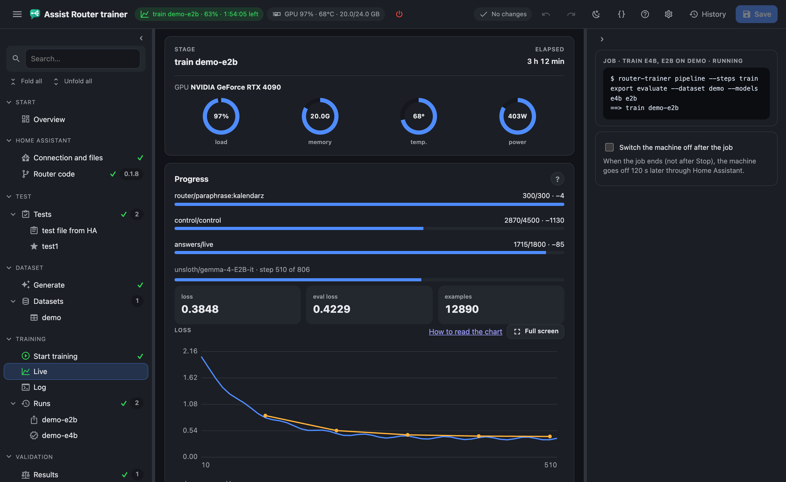

# Assist Router trainer

Fine-tune a smaller model (Gemma 4 E2B or E4B) for
[Assist Router](https://github.com/witold-gren/home-assistant-assist-router) on **your own** Home
Assistant data — the topic router, the command parser and the answers — and check it with the same
frozen test as the model comparison. Everything happens in a **studio in the browser**, running in
Docker on the GPU machine: the data from Home Assistant, the test, the dataset, training, export to
Ollama on the Jetson, validation and a "try it" box.

**Guide:** [English](docs/en/index.html) · [Polski](docs/pl/index.html) — Polish README:
[README.pl.md](README.pl.md).



## Try it on a Mac

1. **Needed:** only [Docker Desktop](https://www.docker.com/products/docker-desktop/), running. No GPU, Python or
   Home Assistant.
2. **One command:** `make demo` (it builds the demo image first: under a minute, after that seconds).
3. **Open** http://localhost:8791 and log in as `demo` / `demo`.
4. **Pretend:** a made-up home, a pretend GPU and Home Assistant, all inside the container; nothing goes to a real
   Home Assistant or to the machine. Ctrl+C stops and removes the container; `make demo-clean` removes the image.
5. **Guide and development:** `make docs` builds the guide in Docker and opens it. `make test` and
   `make test-browser` need the environment of `make setup` ([uv](https://docs.astral.sh/uv/), which brings the
   Python of the `Makefile` itself; the Assist Router repository next to this one; Chrome for the browser tests).

## Hardware and support

Made and tested for exactly one setup: **Ubuntu 24.04 with an NVIDIA GeForce RTX 4090 (24 GB)**,
with the studio in Docker. A Mac is only for trying the studio without a card. The project will not
be adapted to other cards or machines; anyone may use it, but supporting other hardware is up to you.

## What it does

- **Same prompts as at runtime** — training chats are built with the integration's own functions,
  imported from the Assist Router code of the version Home Assistant runs (fetched by the studio).
- **Data from your home** — through Assist Router's read-only export command (0.1.8+): router.yaml,
  the question log, the tests, the automations with a conversation trigger, custom_sentences; plus
  the home snapshot from the HA API. A teacher model (Gemma 4 26B in the studio's own Ollama) writes
  paraphrases, commands checked by parsing them back, and answers.
- **A frozen test** — no training sentence may equal or nearly equal a test sentence; a generated
  test is written by another model (Bielik) and checked by the teacher, with an optional review.
- **Training** — Unsloth LoRA (E2B) / QLoRA (E4B), loss on answers only, live loss chart with an
  overfitting warning, checkpoints, stop and resume.
- **Export and test** — GGUF, upload to the home Ollama, the router's benchmark for the trained and
  the base model with fixed and broken cases.
- **Studio** — like the Home Dashboard and Assist Router editors: a tree of the steps, views with a
  "?" each, live GPU and job; trainer.yaml as forms with a draft, undo/redo, save with a diff and a
  history of 30 versions; login; switching the machine off after a job through Home Assistant.

## Quick start (from the Mac)

```bash
mkdir -p ~/.config/gpu-studio
echo 'GPU_HOST = user@192.168.1.21' > ~/.config/gpu-studio/host.mk   # shared by every GPU studio
make install          # code to the machine, checks Docker + NVIDIA toolkit, login, build, start
make login            # user and password of the studio
```

Open `http://<machine>:8790/`, connect Home Assistant (an administrator's long-lived token) and
follow the steps in the tree. The studio starts again with the machine (Docker
`restart: unless-stopped`). Every update: `make deploy`. On the machine itself:
`./docker/install-ubuntu.sh`. `make help` lists every target; the guide (`make docs`, the studio's
"?" button) explains every step.

## Privacy

Everything about your home — snapshots, generated data, datasets, models, results and settings —
stays in `docker/data/` on the machine, which is not in git; the login is in `docker/config/env`
(mode 600). Home Assistant is only read (except the GPU machine's switch, when you set it up).

## Development

```bash
make doctor         # what this computer and the machine have (Docker, Chrome, uv, GPU_HOST, ssh); installs nothing
make setup          # .venv through uv (Python from PYTHON_VERSION in the Makefile)
make test           # pytest without building images - no GPU, Ollama or Home Assistant needed
make test-browser   # the studio in Google Chrome (Playwright)
make test-docker    # builds the demo image and the guide in Docker and checks them
make test-all       # lint + test + test-browser + test-docker
make demo-local     # the demo without Docker (.venv): http://localhost:8791, demo / demo
make screenshots    # the guide's pictures (both languages)
make docs-serve     # the guide with live reload, in Docker: http://localhost:9791
```

MIT licence.
