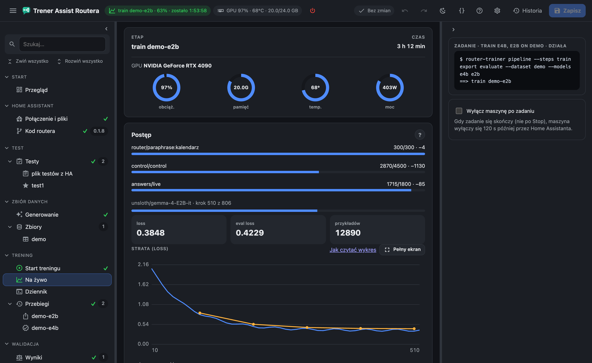

# Trener Assist Routera

Douczanie mniejszego modelu (Gemma 4 E2B albo E4B) dla
[Assist Routera](https://github.com/witold-gren/home-assistant-assist-router) na danych **Twojego**
Home Assistanta - router tematów, rozbiór poleceń i odpowiedzi - i sprawdzanie go tym samym
zamrożonym testem co w porównaniu modeli. Wszystko dzieje się w **studiu w przeglądarce**, które działa
w Dockerze na komputerze z kartą: dane z Home Assistanta, test, zbiór danych, trening, eksport do
Ollamy na Jetsonie, walidacja i „Wypróbuj”.

**Strona dokumentacji:** [https://witold-gren.github.io/home-assistant-assist-router-trainer/pl/](https://witold-gren.github.io/home-assistant-assist-router-trainer/pl/) ([English](https://witold-gren.github.io/home-assistant-assist-router-trainer/)) - README po angielsku:
[README.md](README.md).



## Wypróbuj na Macu

1. **Potrzebne:** tylko [Docker Desktop](https://www.docker.com/products/docker-desktop/), uruchomiony. Bez GPU,
   Pythona i Home Assistanta.
2. **Jedno polecenie:** `make demo` (najpierw buduje obraz demo: poniżej minuty, potem sekundy).
3. **Otwórz** http://localhost:8791 i zaloguj się jako `demo` / `demo`.
4. **Udawane:** wymyślony dom, udawane GPU i Home Assistant, wszystko w kontenerze; nic nie trafia do prawdziwego
   Home Assistanta ani na maszynę. Ctrl+C zatrzymuje i usuwa kontener; `make demo-clean` usuwa obraz.
5. **Przewodnik i dla programisty:** `make docs` buduje przewodnik w Dockerze i go otwiera. `make test` i
   `make test-browser` potrzebują środowiska z `make setup` ([uv](https://docs.astral.sh/uv/), który sam pobiera
   Pythona w wersji z `Makefile`; repozytorium Assist Routera obok tego; Chrome do testów w przeglądarce).

## Sprzęt i wsparcie

Przygotowane i sprawdzane na dokładnie jednym zestawie: **Ubuntu 24.04 z kartą NVIDIA GeForce RTX 4090
(24 GB)**, ze studiem w Dockerze. Mac służy tylko do wypróbowania studia bez karty. Projekt nie będzie
dostosowywany do innych kart ani maszyn; każdy może z niego korzystać, ale wsparcie dla innego sprzętu
musi zapewnić sam.

## Co robi

- **Te same prompty co w działaniu** - rozmowy treningowe budują funkcje integracji, importowane z kodu
  Assist Routera w wersji, którą ma Home Assistant (studio ją pobiera).
- **Dane z Twojego domu** - przez komendę eksportu Assist Routera tylko do odczytu (0.1.8+):
  router.yaml, dziennik pytań, testy, automatyzacje z wyzwalaczem rozmowy, custom_sentences; do tego
  migawka domu z API HA. Nauczyciel (Gemma 4 26B we własnej Ollamie studia) pisze parafrazy, polecenia
  sprawdzane rozbiorem i odpowiedzi.
- **Zamrożony test** - żadne zdanie treningowe nie może być takie samo ani prawie takie samo jak
  testowe; test generowany pisze inny model (Bielik), a sprawdza nauczyciel, z opcjonalnym przeglądem.
- **Trening** - Unsloth LoRA (E2B) / QLoRA (E4B), strata tylko na odpowiedziach, wykres na żywo z
  ostrzeżeniem o przeuczeniu, punkty kontrolne, stop i wznowienie.
- **Eksport i test** - GGUF, wysłanie do domowej Ollamy, test routera dla douczonego i bazowego modelu
  z naprawionymi i zepsutymi przypadkami.
- **Studio** - jak edytory Home Dashboard i Assist Router: drzewo kroków, widoki z „?”, karta i zadanie
  na żywo; trainer.yaml jako formularze ze szkicem, cofnij/ponów, zapis z podglądem zmian i historią 30
  wersji; logowanie; wyłączenie maszyny po zadaniu przez Home Assistanta.

## Szybki start (z Maca)

```bash
mkdir -p ~/.config/gpu-studio
echo 'GPU_HOST = user@192.168.1.21' > ~/.config/gpu-studio/host.mk   # wspólne dla wszystkich studiów GPU
make install          # kod na maszynę, sprawdzenie Dockera i toolkitu NVIDIA, login, budowa, start
make login            # użytkownik i hasło studia
```

Otwórz `http://<maszyna>:8790/`, połącz Home Assistanta (token długoterminowy administratora) i idź po
kolei krokami w drzewie. Studio startuje razem z maszyną (Docker `restart: unless-stopped`). Każda
aktualizacja: `make deploy`. Na samej maszynie: `./docker/install-ubuntu.sh`. `make help` pokazuje
wszystkie cele; przewodnik (`make docs`, przycisk „?” w studiu) wyjaśnia każdy krok.

## Prywatność

Wszystko o Twoim domu - migawki, wygenerowane dane, zbiory, modele, wyniki i ustawienia - zostaje w
`docker/data/` na maszynie, poza gitem; login jest w `docker/config/env` (prawa 600). Home Assistant jest
tylko czytany (poza przełącznikiem maszyny z GPU, jeśli go ustawisz).

## Rozwój

```bash
make doctor         # co ma ten komputer i maszyna (Docker, Chrome, uv, GPU_HOST, ssh); nic nie instaluje
make setup          # .venv przez uv (Python z PYTHON_VERSION w Makefile)
make test           # pytest bez budowy obrazów - bez GPU, Ollamy i Home Assistanta
make test-browser   # studio w Google Chrome (Playwright)
make test-docker    # buduje obraz demo i przewodnik w Dockerze i je sprawdza
make test-all       # lint + test + test-browser + test-docker
make demo-local     # demo bez Dockera (.venv): http://localhost:8791, demo / demo
make screenshots    # zrzuty do przewodnika (oba języki)
make docs-serve     # przewodnik z odświeżaniem na żywo, w Dockerze: http://localhost:9791
```

Licencja MIT.
