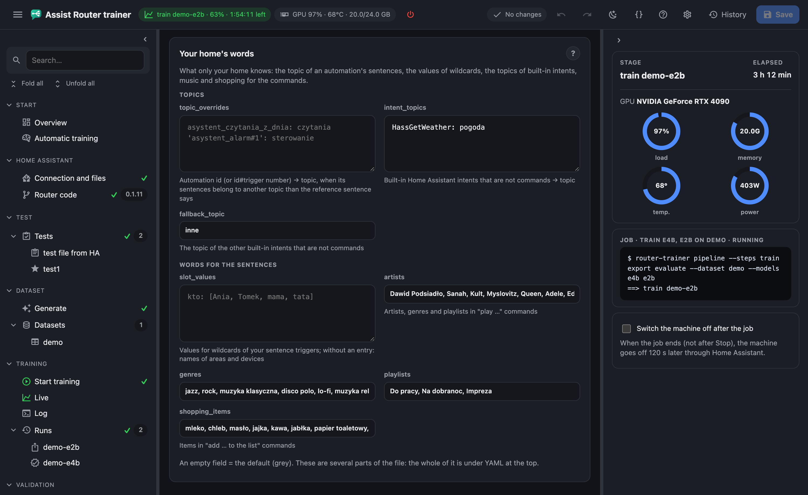

# Doing it well {#good-practice}

## How to train {#how}

- Fetch from Home Assistant and check the router code before every new dataset.
- Name datasets by date (`nov16`): old datasets and runs stay for comparisons.
- Change **one thing at a time** (a parameter or the data) and compare **on the same test**.
- Start with E2B (quick), then E4B with the best settings.
- After changing `router.yaml` (topics, examples) build the dataset again - the dataset's prompts warning reminds you.
- A quick check of the whole road on a small copy: `make docker-shell`, then `router-trainer smoke` (E2B, ~15-25 min).

## How much data {#data}

The defaults give about 12-15 thousand training examples - enough for one epoch. More template sentences do not
help: the model learns the template, not the meaning. More **real log questions** and **paraphrases** help most.
A topic with fewer than `min_per_topic` examples is padded with noisy copies - add examples to it in `router.yaml`.

## The split {#split}

- **Test** - the only measure. A training sentence equal or similar to a test sentence is dropped: by word stems
  (`holdout.word_similarity`) and character trigrams (`holdout.char_similarity`), when generating and again when
  building, before noise.
- **Dev** (`dataset.dev_fraction`) - only for the eval loss; split by a hash of the text (the same sentence always
  on the same side). Dev does not replace the test.
- **Evening out**: `max_per_topic` trims big topics, `min_per_topic` pads small ones; `noise` adds
  speech-recognition style errors; `dataset.mix` takes a share of each role.

## Parameters {#parameters}

Every parameter of `trainer.yaml` (Settings in the studio); the default is the value in the code
(`router_trainer/trainer.example.yaml`). In the studio the lessons of the **Tuning** group (⚙ → Lessons) go through
these settings field by field ([The tour and the lessons](screen.md#tour)).

| Parameter | Default | Range | Effect |
|---|---|---|---|
| `models.e4b.load_in_4bit` | true | true / false | QLoRA: the 4-bit base; E4B in bf16 does not fit 24 GB with long prompts |
| `models.e4b.epochs` | 1 | 0.5-3 | passes over the data; 2 when dev still falls at the end |
| `models.e4b.learning_rate` | 0.0001 | 5e-5 - 2e-4 | higher learns faster and overfits sooner |
| `models.e4b.lora_r` | 16 | 8-64 | adapter size; 32 for a very big dataset |
| `models.e4b.lora_alpha` | 32 | 2 × r | the adapter's weight |
| `models.e4b.batch_size` | 2 | 1-8 | examples per step on the card; lower on "out of memory" |
| `models.e4b.grad_accum` | 8 | 1-32 | steps added before an update; batch × accum = the real batch |
| `models.e4b.max_seq_length` | 6144 | 2048-8192 | longer examples are skipped and counted |
| `models.e2b.load_in_4bit` | false | true / false | E2B fits in bf16 (LoRA) |
| `models.e2b.batch_size` | 4 | 1-16 | as above |
| `models.e2b.grad_accum` | 4 | 1-32 | as above |
| `generate.router.paraphrases_per_topic` | 300 | 100-600 | sentences the teacher writes per topic |
| `generate.router.per_template` | 30 | 10-60 | sentences per template of your automations |
| `generate.router.native_intents` | 1500 | 0-3000 | built-in HA intents with your names |
| `generate.router.knowledge` | 800 | 0-1500 | knowledge questions (topic with `search`) |
| `generate.router.gibberish` | 300 | 0-600 | speech-recognition gibberish (topic with `unclear`) |
| `generate.router.max_per_topic` | 900 | 300-2000 | a cap per topic |
| `generate.router.min_per_topic` | 250 | 50-500 | small topics padded up to this |
| `generate.router.noise` | 0.3 | 0-0.6 | share with speech-recognition noise |
| `generate.control.labels` | 1500 | 500-3000 | commands planned from your home |
| `generate.control.sentences_per_label` | 3 | 1-5 | sentences written per planned command |
| `generate.answers.given` | 600 | 200-1500 | made-up data with Python facts |
| `generate.answers.live_per_topic` | 40 | 10-100 | questions per topic from your live HA data |
| `generate.answers.wikipedia` | 300 | 0-600 | Wikipedia summaries |
| `test.router_per_topic` | 12 | 5-30 | router cases per topic |
| `test.control` | 150 | 50-300 | control cases |
| `test.control_overhead` | 4 | 2-6 | planned commands per kept one |
| `test.answers` | 35 | 10-80 | given-data cases |
| `test.real_per_topic` | 5 | 2-10 | HA-data cases per topic |
| `test.real_max` | 90 | 30-150 | HA-data cases at most |
| `test.wikipedia` | 15 | 5-40 | Wikipedia cases |
| `holdout.word_similarity` | 0.8 | 0.6-0.95 | lower = more training sentences dropped |
| `holdout.char_similarity` | 0.85 | 0.6-0.95 | lower = more dropped |
| `dataset.dev_fraction` | 0.05 | 0.02-0.1 | share kept for the eval loss |
| `export.quantization` | q8_0 | q8_0 / bf16 / f16 | q8_0: almost lossless, half the size |
| `generate.router.log_questions` | true | true / false | real questions from the log that are unlike the test |
| `generate.router.recordings` | true | true / false | the home's voice commands through Whisper - real speech errors |
| `generate.router.asr_per_topic` | 40 | 0-100 | natural questions per topic read by Piper and written back by Whisper |
| `generate.router.check_labels` | true | true / false / list of sources | every teacher sentence checked with the router's prompt; another topic = dropped |
| `generate.router.contrast.per_side` | 40 | 0-100 | sentences per topic of a contrast pair (0 = off) |
| `generate.router.contrast.pairs` | auto | auto / `[[a, b]]` | auto = the topics mixed up in the last evaluations |
| `generate.router.contrast.max_pairs` | 12 | 4-20 | pairs taken from the errors with auto |
| `generate.router.contrast.extra` | [] | `[[a, b]]` | pairs always added (a new topic with no errors yet) |
| `generate.router.speech.piper` / `.whisper` | "" | host:port | Wyoming servers; empty = the home Ollama's host |
| `generate.router.speech.voices` | [] | Piper voices | empty = every voice of the language |
| `dataset.mix.router` / `.control` / `.answers` | 1.0 | 0-1 | share of each role's examples in the dataset |
| `export.name` | assist-router-{model}-ft | text | the model's name in Ollama; the tag is the run |
| `evaluate.unload_first` | [] | Ollama models | unloaded on the Jetson before the test, so the tested ones have memory |
| `topic_overrides` | {} | id → topic | the topic of an automation's sentences when its reference sentence says another |
| `slot_values` | {} | name → list | values for {wildcards} of your sentence triggers |
| `intent_topics` / `fallback_topic` | HassGetWeather: pogoda / inne | intent → topic | built-in intents that are not commands |
| `music.*`, `shopping_items` | lists | lists | words of "play …" and "add … to the list" commands |

## Reading the chart {#chart}

The chart of the live view: the training loss (blue) and the dev loss (orange) against the steps, on one axis.
Hover shows the values of a step; a click opens it full screen, where dragging zooms in and a click pins a step.

- Both fall together - good.
- **Dev rises, training falls** - overfitting: the model learns the examples by heart. The studio warns when dev
  rises twice in a row. Stop; fewer epochs or a lower learning rate.
- Both stay high - too little data or too low a learning rate.
- "Skipped (too long)" - examples longer than `max_seq_length`; many of them mean the HA data is too big (trim the
  topics in `router.yaml`).

## Resuming {#resume}

Resume with the same dataset and model continues from the newest checkpoint. The start card
says how much it will really train: "from step 510 of 806 - 296 steps left". A finished run has nothing left: raise
the epochs (a new run) instead.

## Reading the results {#results}

- green ≥ 95%, yellow ≥ 85%, red below;
- **fixed / broken** says more than the score: broken cases show what the model unlearnt;
- a model is better when it wins in the router and control **and** does not lose in the answers; the time (seconds
  next to the score) counts too - that is the point of a smaller model.

## Recipes {#recipes}

| Problem | Try |
|---|---|
| Great dev loss, weak test | the model learnt templates: more paraphrases and log questions, lower `max_per_topic`, fewer epochs |
| Weak control | many rejected commands in `generated/control_rejected.jsonl`; add device aliases in HA |
| "CUDA out of memory" | lower `batch_size`, raise `grad_accum` (the same product), or lower `max_seq_length` |
| Weak HA-data answers | more `live_per_topic`; shorter topic data in `router.yaml` (`details`, `fetch`) |
| Two topics mixed up (e.g. lessons / calendar) | add the pair to `contrast.extra`, raise `contrast.per_side`; sharpen both descriptions in `router.yaml` |
| Many sentences in `generated/labels_dropped.jsonl` | the teacher itself is unsure of the topics: clearer descriptions and examples in `router.yaml`, then a new dataset |
| Gibberish and short answers ("No.", "Nothing") go to wrong topics | more `gibberish`, higher `noise`, `recordings` and `asr_per_topic` on; add such sentences as examples of their topic |
| The small model stays a few sentences behind the base | it learns from the teacher and cannot beat it on its own data: add real sentences (log, recordings), not more paraphrases |
| A new topic | examples in `router.yaml`, test cases in `model_test.yaml`, `contrast.extra` with its neighbours, `topic_overrides` for its automation |
| Weak commands although the topic is right | with "Only the topic" the commands were not trained at all - untick it, or keep the answer model for commands |

## An example from the home {#example}

Round 3 of the router's model comparison: the base Gemma 4 E4B had router 95%, control 90%, HA data 84%. A generated
test from the same home gave similar router and control scores and a stricter HA-data score (~70%), because it
needs a fact from the data. That is why models are compared only on one test.
