# From zero to a model {#guide}

This page walks through the whole studio in order, from the first login to a trained model that Assist Router uses
at home. Every step says **what to click**, **what happens**, **how long it takes** and **what to look at**. A
shorter description of the steps is in [Step by step](steps.md#steps), the parameters in
[Doing it well](good-practice.md#parameters).

The whole road in short:

1. connect Home Assistant and fetch its files;
2. match the router code to the version in HA;
3. choose the test that is the measure;
4. build a dataset (the teacher on the card, one to a few hours);
5. train a model (E2B about an hour, E4B a few hours);
6. send it to the Jetson;
7. compare it with the base model;
8. choose it in Assist Router and try it at home.

## Before you start {#guide-before}

- **The GPU machine is on.** A switch in Home Assistant turns it on (e.g. `switch.maszyna_gpu`); the studio starts
  with the machine, nothing has to be started by hand.
- **Assist Router 0.1.8 or newer in Home Assistant.** The studio fetches the router's files through its export
  command, which is there since 0.1.8. An older version ends the fetch with an error (see the [FAQ](faq.md#faq-ha)).
- **A long-lived token of an administrator:** your profile in HA → Security → Long-lived access tokens → Create
  token. Copy it at once, HA shows it only once. The studio changes nothing in HA
  ([why an administrator](home-assistant.md#token)).
- **The studio's address:** `http://<machine-address>:8790/`. `make login` on the Mac shows the user and password.

## First login and the screen {#guide-screen}

After logging in, **Overview** opens: the steps with a ✓ next to those done and a Go button
next to the next one. Come back here when you do not know what comes next.

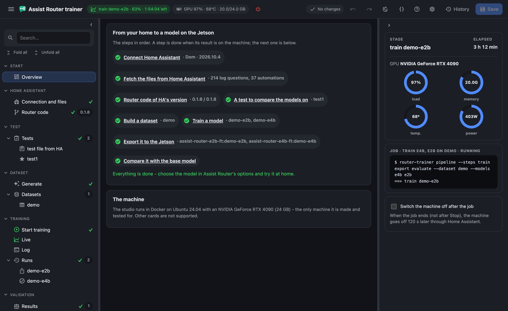

The screen has three columns:

- **left**: the tree of steps (Start, Home Assistant, Test, Dataset, Training, Validation, Settings), search;
- **middle**: the view of the chosen step; every card has its own **?** with a short description and a link to the
  guide;
- **right**: live, that is the stage, the time, the card's rings (load, memory, temperature, power), the last lines
  of the job and Switch the machine off after the job.

The top bar, from the left: ☰ (the guide, the account, Log out), the running job with its
progress, the machine's state with its switch-off button, the state of the settings draft, undo / redo, the theme
button, YAML, **?** (this guide), ⚙, History,
Save.

**⚙ opens a small window**, Look and language: the theme (As the system,
Light, Dark) and the language
(Polski, English). A choice works at once and the window stays open.
Esc, a click beside it or ⚙ again close it. All look and language goes to the same choices
in the tree (Settings → Look and language). The choice is kept in this browser.

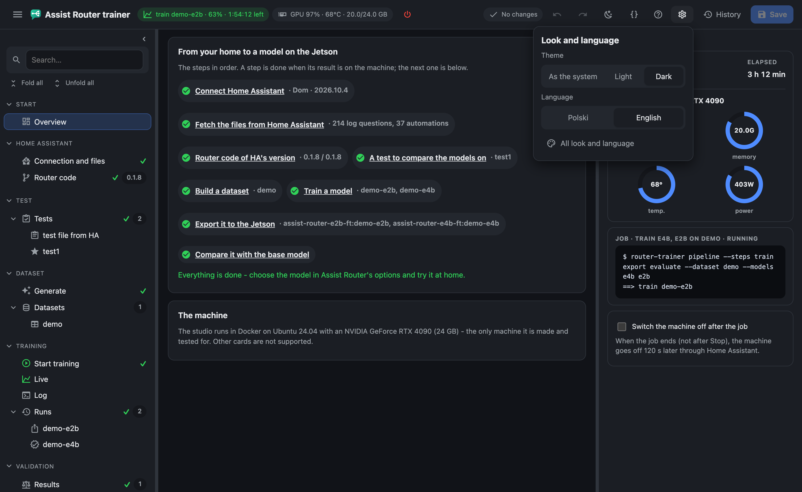

The columns can be folded (‹ and ›, Ctrl/⌘+B and Ctrl/⌘+Alt+B) and widened by dragging the divider.

## Step 1. Connect Home Assistant {#guide-connect}

1. In the tree: Home Assistant → Connection and files.
2. Type the address of HA with its port (e.g. `http://homeassistant.local:8123`) and the administrator's token.
3. Connect to HA.

The studio shows the name of the home and the version of HA. The token stays on the machine and is never shown
again; you can leave its field empty later. When HA refuses the token, the studio stops asking HA anything (every
refusal is a failed login for HA) and waits for a new token.

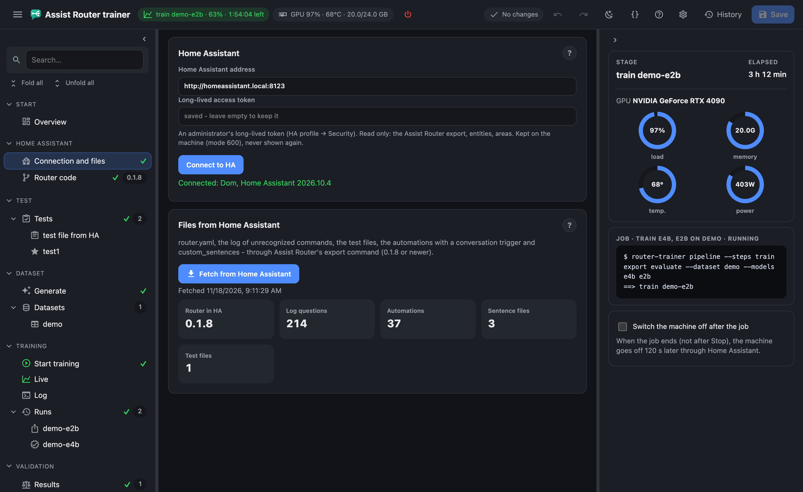

## Step 2. Fetch the files from Home Assistant {#guide-fetch}

On the same card: Fetch from Home Assistant. It takes a few seconds. It brings:

- `router.yaml`, the router's topics and their examples;
- the log of unrecognized commands (real questions from the home);
- the test files from HA, if there are any;
- every automation with a conversation trigger, also those in `packages/`;
- the `custom_sentences` files.

The card shows the numbers: questions in the log, automations, sentence files, test files and the router version in
HA. **Fetch before every new dataset**, so the model learns the home as it is now.

## Step 3. The router code {#guide-router}

Home Assistant → Router code. The model learns exactly the prompts Assist Router will give
it, so the studio needs the router code of the same version as HA.

- Green text: the same version, nothing to do.
- A red pill "Router 0.1.7 ≠ HA 0.1.8" in the top bar: click Fetch router {version}. The
  studio fetches that tag from GitHub, without rebuilding the image.
- When the new version needs other Python packages, the studio says so: rebuild the image (`make deploy` from the
  Mac).

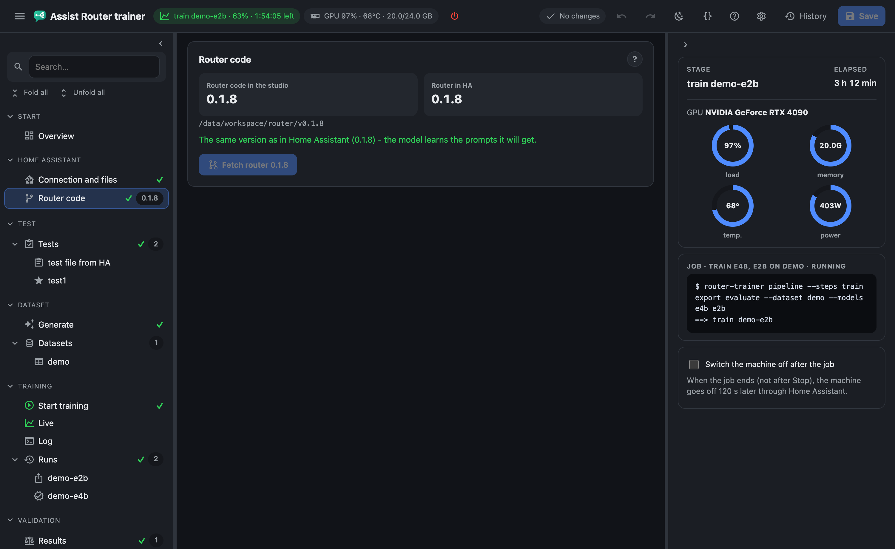

## Step 4. The test, the measure {#guide-test}

Test → Tests. The active test is **the only measure** for comparing models. Its sentences
never go into training. You have two choices:

- **The test file from HA** (`/config/assist/model_test.yaml`), if you keep one. It is ready at once.
- **A generated test:** type a name (e.g. `nov18`) and Create test. The writer model
  (Bielik) writes cases from your home and the log, the teacher (Gemma 26B) checks them; only what both understand
  the same way stays. It takes about an hour.

Choose a test and Make it the active test.

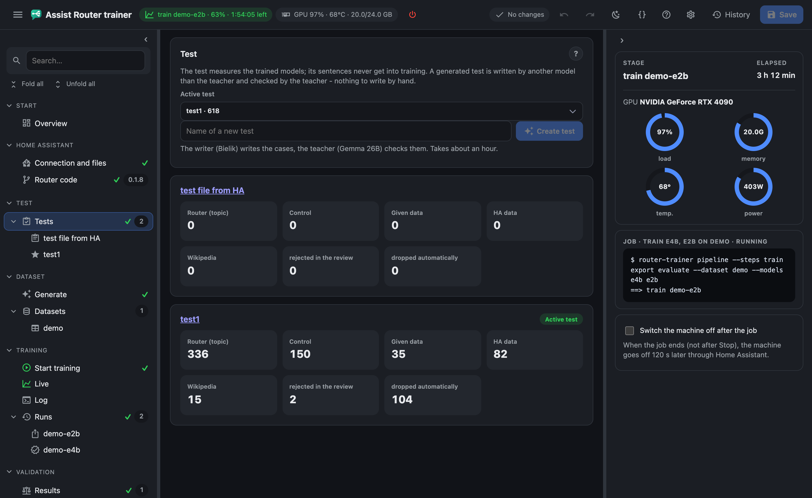

**The review (optional):** click the test in the tree and look through its cases. Mark those that look wrong (a
wrong expectation, a strange sentence); they will not be counted. After changing the active test or the review,
build the dataset again (step 5), because the frozen test must cover the new sentences.

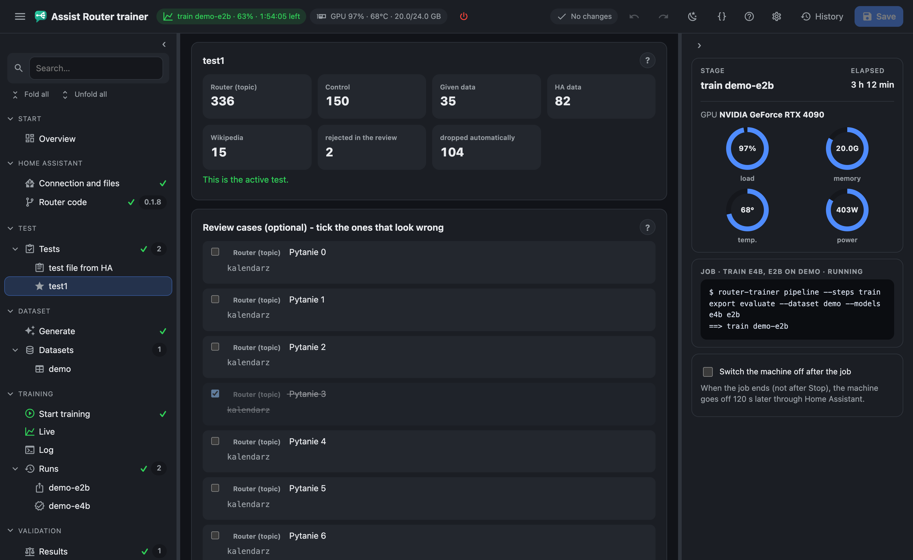

## Step 5. The dataset {#guide-dataset}

Dataset → Generate.

1. **The dataset's name**, best with a date (`nov18`). A new name keeps the old datasets for comparison.
2. **The stages**: all by default. Each can be chosen alone, e.g. only building the dataset after changing the
   split settings.
3. Generate.

| Stage | What it does | Time |
|---|---|---|
| home snapshot | entities, aliases, areas, scripts and scenes from HA | seconds |
| freezing the test | remembers the test's sentences so nothing like them goes into training | seconds |
| router | sentences of your automations, HA intents with your names, the teacher's paraphrases, knowledge questions, gibberish, questions from the log | the longest |
| control | Python plans a command from your home, the teacher writes it and parses it back; only what agrees stays | long |
| answers | made-up data with facts from Python, your HA data live, Wikipedia summaries | medium |
| building the dataset | conversations with the integration's functions, dropping sentences like the test, balancing topics, noise, the train/dev split | minutes |

The whole takes one to a few hours. The progress is in the top bar and the right column. **Generating can be
stopped** (Stop) and started again: it goes on from where it stopped.

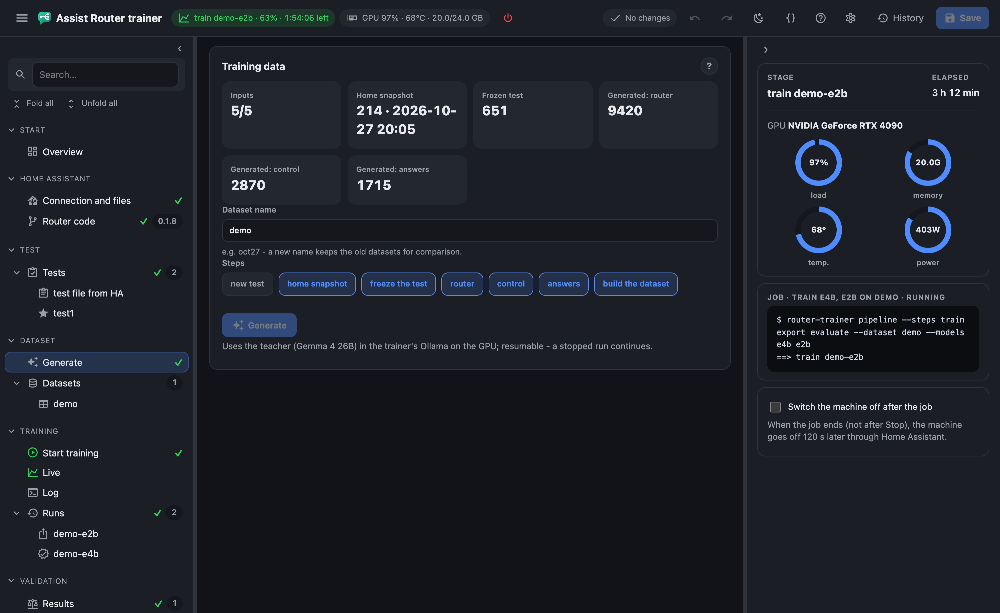

The finished dataset is in the tree under Datasets. What to look at:

- **Sources and topics:** no topic should have suspiciously few examples. A small topic is filled up with noisy
  copies; better add examples to it in `router.yaml`.
- **Dropped as like the test:** the samples show what went. Many of them mean the test and the data are very alike.
  That keeps the result honest.
- **The prompt warning:** "router.yaml or the home changed since this dataset was built". Build the dataset again.

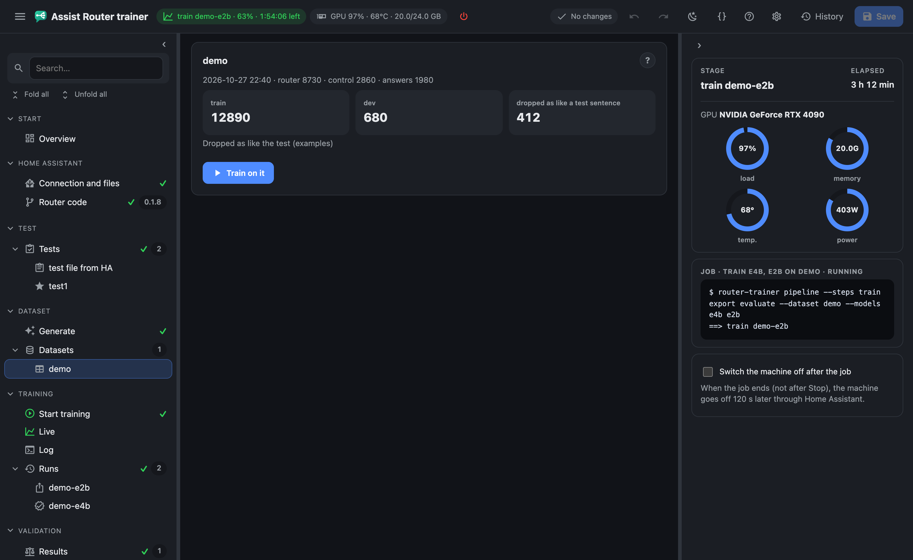

## Step 6. Training {#guide-train}

Training → Start training (or Train on it on the dataset's card).

1. **Dataset** and **models**: start with E2B (fast, about an hour), then E4B with the best settings (a few hours).
   Both one after the other fit in one night.
2. **This run's settings (optional):** an empty field = the value from the settings (grey). A value typed here is
   for this run only. What each parameter does: [Parameters](good-practice.md#parameters).
3. then export and test: right after training, the export to the Jetson and the comparison
   with the base model. Leave it on when training overnight.
4. Switch the machine off after the job: the machine switches itself off after the whole job
   ([details](home-assistant.md#power-off-after)).
5. Start.

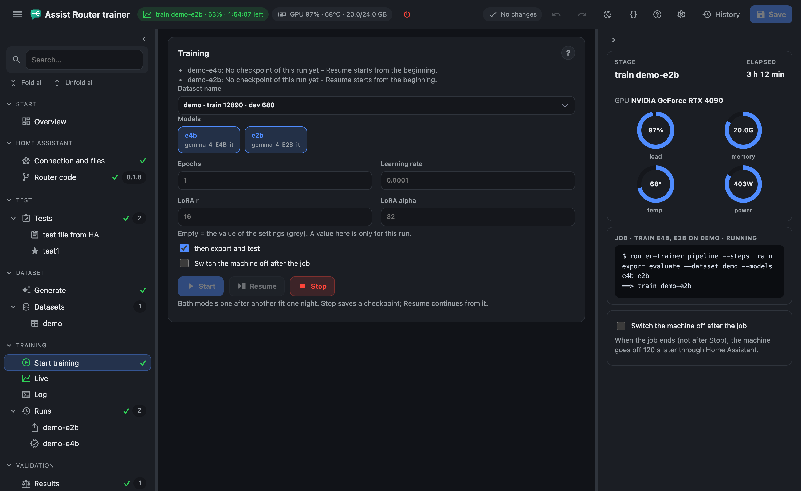

**Meanwhile** open Training → Live: the stage, the time left, the card and the loss chart.

- Both losses fall together: good.
- The dev loss rises while the training loss falls: the model learns by heart. The studio warns after two rises in
  a row. Stop and lower the epochs or the learning rate.
- "Skipped (too long)": examples longer than `max_seq_length`.

More: [Reading the chart](good-practice.md#chart).

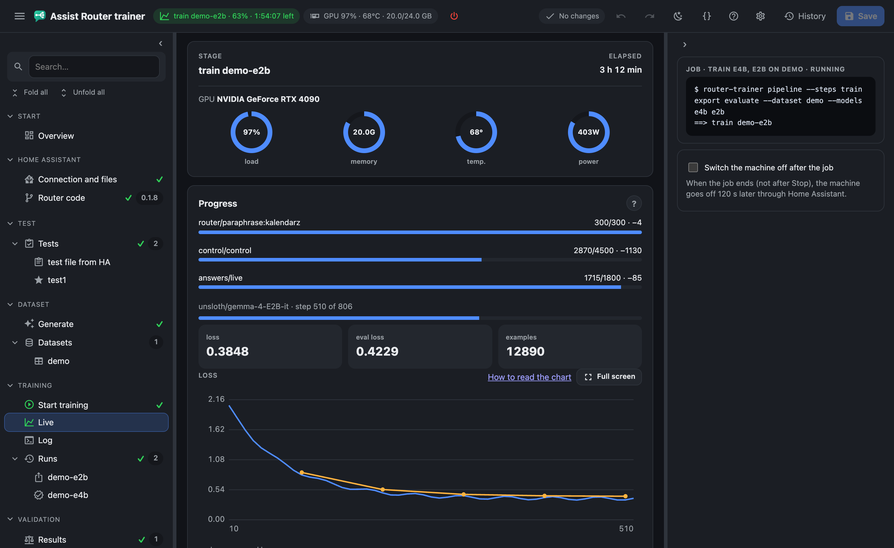

**Stop and Resume:** Stop saves a checkpoint. Resume with the same
dataset and model goes on from it, and the card says how many steps are really left. After a restart of the machine
the job is marked as interrupted; resume it the same way.

**The log:** Training → Log has every job with its start, its duration, its result and its
whole log.

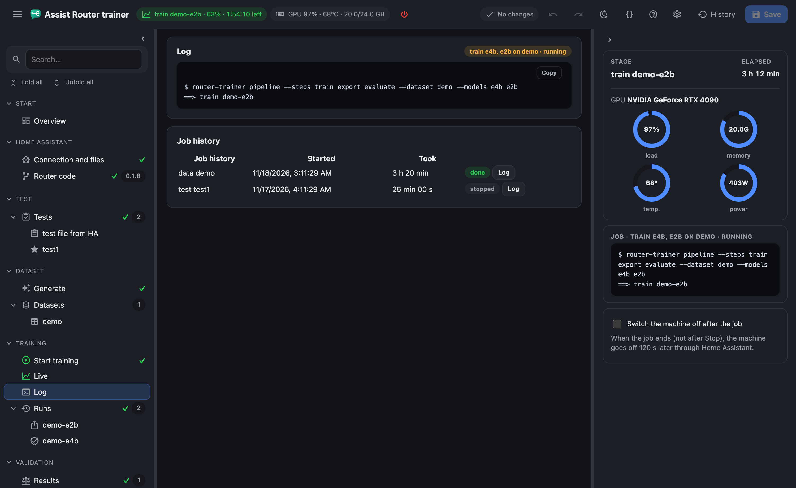

## Step 7. Export to the Jetson {#guide-export}

Training → Runs → choose the run → Export (skip this when "then
export and test" was on).

What happens:

1. the weights are merged with the adapter and saved as GGUF (q8_0, almost lossless);
2. the studio's Ollama answers a few sentences, to check that the model works at all;
3. the model goes to the Ollama on the Jetson as `assist-router-<model>-ft:<run>`, e.g.
   `assist-router-e2b-ft:nov18-e2b`, after checking that it fits next to the models loaded there.

Nothing changes at home yet: Assist Router keeps using the old model until you switch it (step 9).

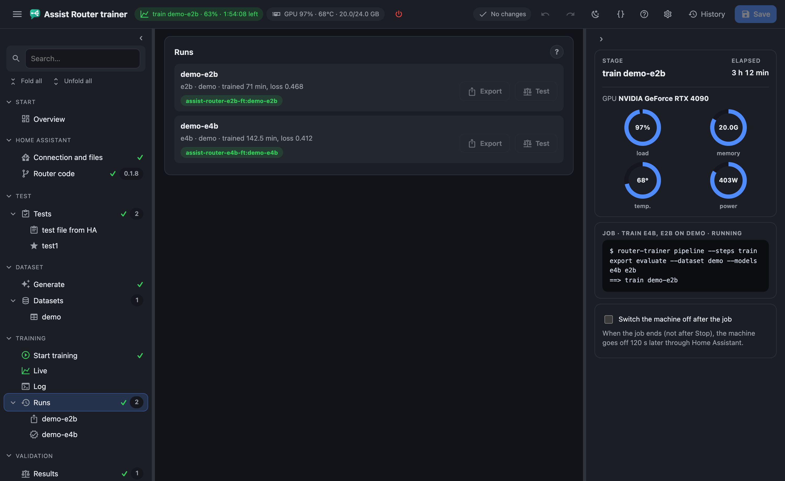

## Step 8. Compare with the base model {#guide-validate}

On the run's card Test, then Validation → Results. The active test
runs for the trained and the base model in the Ollama on the Jetson, in five parts: router, control, given data, HA
data and Wikipedia.

- green ≥ 95%, yellow ≥ 85%, red below;
- **fixed** and **broken** say more than the score; the broken ones show what the model unlearned;
- the time counts too (the seconds next to the score): that is what the smaller model is for.

The model is better when it wins in the router and control **and** does not lose in the answers.
[Reading the results](good-practice.md#results).

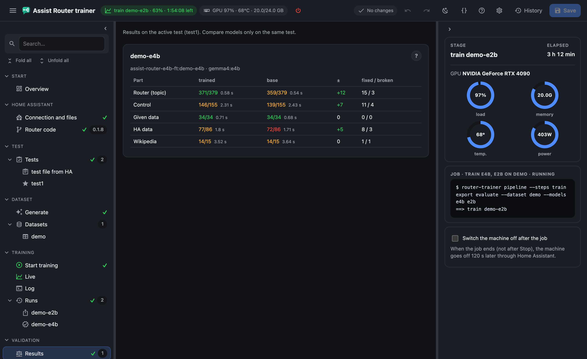

**Try it:** Validation → Try it. Type one sentence (e.g. "Turn off the kitchen light"),
choose the models and Try. You see each model's topic, control plan or answer side by side.
Nothing is done in the home.

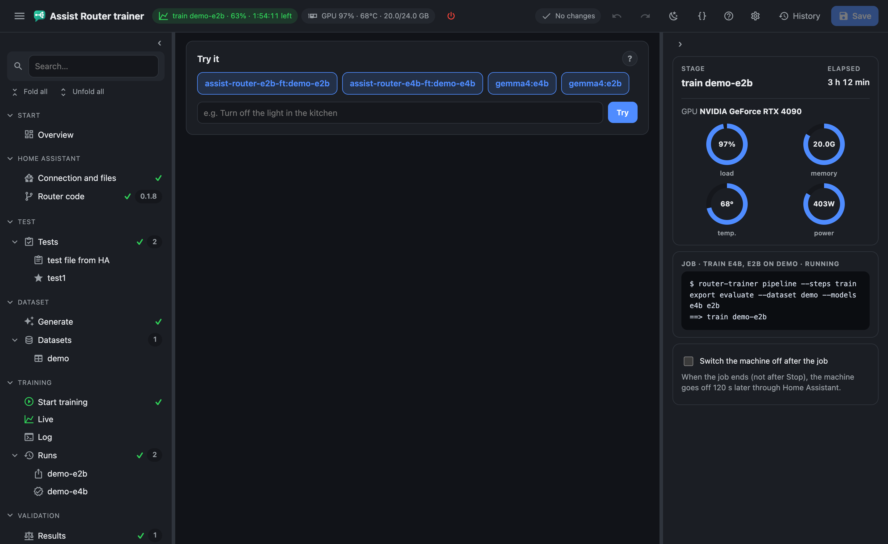

## Step 9. Use it at home {#guide-home}

1. Home Assistant → Settings → Devices & services → Assist Router → Configure → **Question router**.
2. In **Router model** choose the new model from the Ollama on the Jetson (`assist-router-…-ft:…`). The trained
   model also learned the answers, so you can choose it in **Answer model** too. Do that when the answer scores of
   step 8 are not worse than the base model's.
3. Talk as usual and watch the log of unrecognized commands.

Going back is simple: choose the previous model. The old models stay in Ollama until you remove them.

## Settings, draft and history {#guide-settings}

Settings → `trainer.yaml` holds every setting of the studio in forms: Ollama and models, generating, the generated
test, the frozen test, the dataset, export, evaluation and each model.

- Every change goes to a **draft** on the machine. Nothing changes until Save.
- The right column shows the YAML of the chosen part; YAML in the top bar shows the whole
  file. The form and the text go into the same draft.
- Save shows the changed lines and takes a note.
- History keeps 30 versions; restoring one makes it the draft.
- Shortcuts: Ctrl/⌘+S save, Ctrl/⌘+Z undo, Ctrl/⌘+Shift+Z redo.

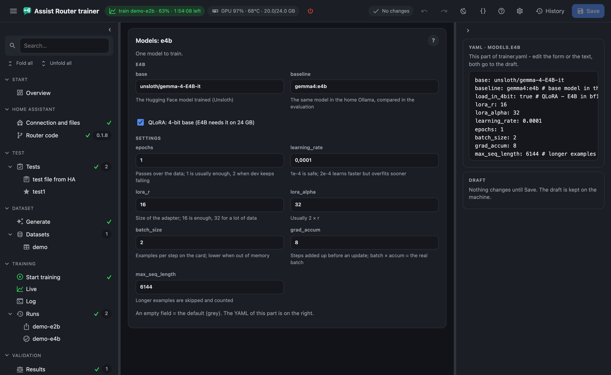

Settings → Look and language has the same choices as the ⚙ window.

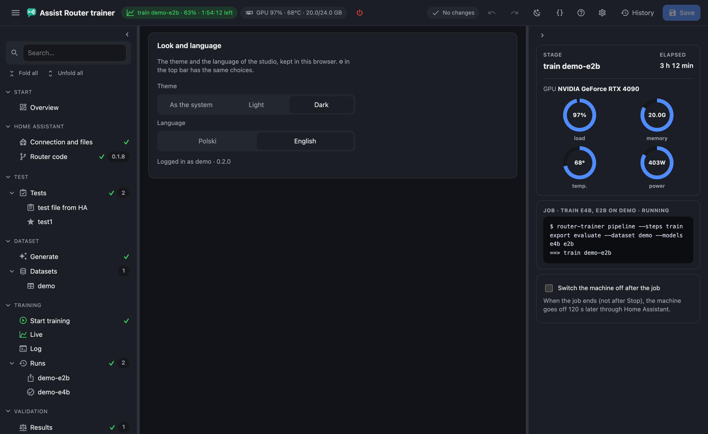

## Machine, power and account {#guide-machine}

- **Machine power:** the machine's switch in HA and the plug's power sensor, Save power settings.
  The ⏻ button in the top bar switches the machine off safely (the system, then the plug); it is
  blocked during a job. The studio cannot switch the machine on; Home Assistant does that.
- **Machine check:** Check shows the card, the driver, the free space, the environments and
  the studio's Ollama in the container.
- **Account:** who is logged in and how to change the password (in `docker/config/env` on the machine).

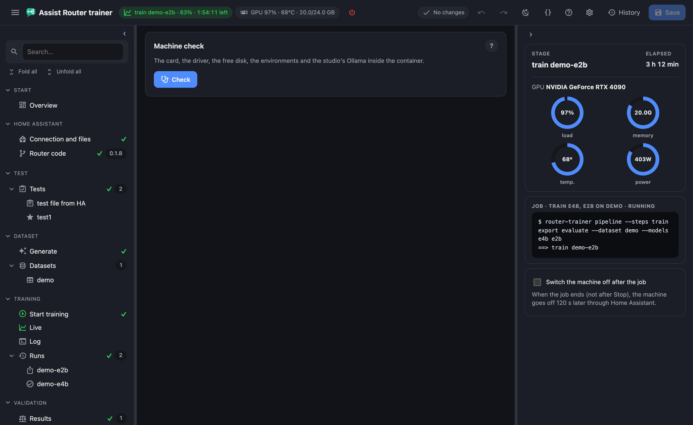

## Next rounds {#guide-next}

1. Fetch the files from HA and check the router code.
2. Change **one thing at a time** (a parameter or the data).
3. A new dataset under a new name, training, export, the comparison **on the same test**.
4. Keep the best run, remove the others from the Ollama on the Jetson.

Recipes for common problems: [Recipes](good-practice.md#recipes). Error messages and their fixes:
[FAQ](faq.md#faq).

## A quick check of the whole road {#guide-smoke}

After installing or updating, check the whole road on a small copy of the data, without touching the real workspace:
`make docker-shell` on the machine, then `router-trainer smoke`. It takes 15-25 minutes: a small test, a small
dataset, half an epoch of E2B, export, the comparison with the base model and removing the check's model from the
Jetson. It ends with the line "smoke test passed".
