# Od zera do modelu {#guide}

Ta strona prowadzi przez całe studio po kolei, od pierwszego logowania do douczonego modelu, którego Assist Router
używa w domu. Każdy krok mówi: **co kliknąć**, **co się stanie**, **ile to trwa** i **na co patrzeć**. Krótszy opis
kroków jest w [Krok po kroku](steps.md#steps), a parametry w [Jak robić to dobrze](good-practice.md#parameters).

Cała droga w skrócie:

1. połącz Home Assistanta i pobierz z niego pliki;
2. dopasuj kod routera do wersji z HA;
3. wybierz test, który będzie miarą;
4. zbuduj zbiór danych (nauczyciel na karcie, od godziny do kilku);
5. wytrenuj model (E2B około godziny, E4B kilka godzin);
6. wyślij go na Jetsona;
7. porównaj go z modelem bazowym;
8. wybierz go w Assist Routerze i wypróbuj w domu.

## Zanim zaczniesz {#guide-before}

- **Maszyna z GPU jest włączona.** Włącza ją przełącznik w Home Assistancie (np. `switch.maszyna_gpu`); studio
  startuje razem z maszyną, nic nie trzeba uruchamiać ręcznie.
- **Assist Router 0.1.8 albo nowszy w Home Assistancie.** Studio pobiera pliki routera przez komendę eksportu,
  która jest dopiero w 0.1.8. Starsza wersja kończy pobieranie błędem (zobacz [FAQ](faq.md#faq-ha)).
- **Token długoterminowy administratora:** profil w HA → Bezpieczeństwo → Tokeny długoterminowe → Utwórz token.
  Skopiuj go od razu, HA pokazuje go tylko raz. Studio niczego w HA nie zmienia ([dlaczego administrator](home-assistant.md#token)).
- **Adres studia:** `http://<adres-maszyny>:8790/`. Użytkownik i hasło pokazuje `make login` na Macu.

## Pierwsze logowanie i ekran {#guide-screen}

Po zalogowaniu otwiera się **Przegląd**: lista kroków z ✓ przy zrobionych i przyciskiem
Przejdź przy następnym. Wracaj tu, gdy nie wiesz, co dalej.

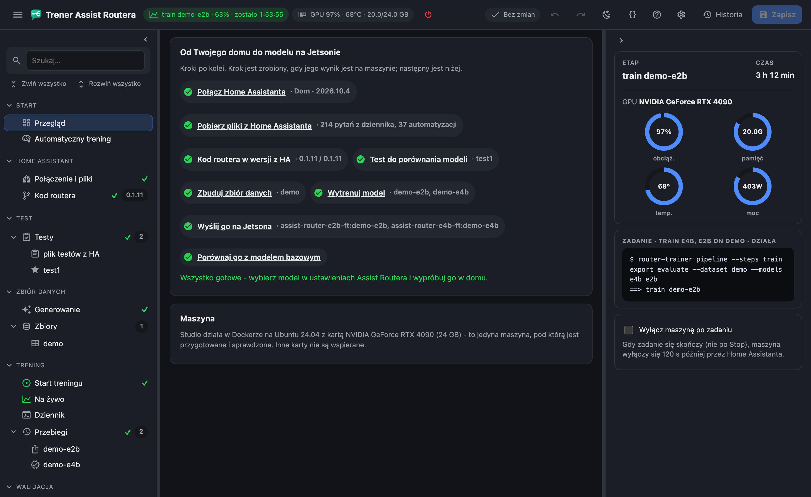

Ekran ma trzy kolumny:

- **lewa**: drzewo kroków (Start, Home Assistant, Test, Zbiór danych, Trening, Walidacja, Ustawienia), wyszukiwanie;
- **środek**: widok wybranego kroku; każda karta ma swój **?** z krótkim opisem i linkiem do przewodnika;
- **prawa**: na żywo, czyli etap, czas, pierścienie karty (obciążenie, pamięć, temperatura, moc), ostatnie linie
  zadania i Wyłącz maszynę po zadaniu.

Górny pasek, od lewej: ☰ (instrukcja, konto, Wyloguj), trwające zadanie z postępem,
stan maszyny z przyciskiem wyłączenia, stan szkicu ustawień, cofnij / ponów, przycisk motywu,
YAML, **?** (ten przewodnik), ⚙, Historia,
Zapisz.

**⚙ otwiera małe okienko** Wygląd i język: motyw (Jak system,
Jasny, Ciemny) i język (Polski,
English). Wybór działa od razu i okienko zostaje otwarte. Zamykają je Esc, kliknięcie obok
albo ponowne ⚙. Cały wygląd i język przechodzi do tego samego wyboru w drzewie
(Ustawienia → Wygląd i język). Wybór zostaje w tej przeglądarce.

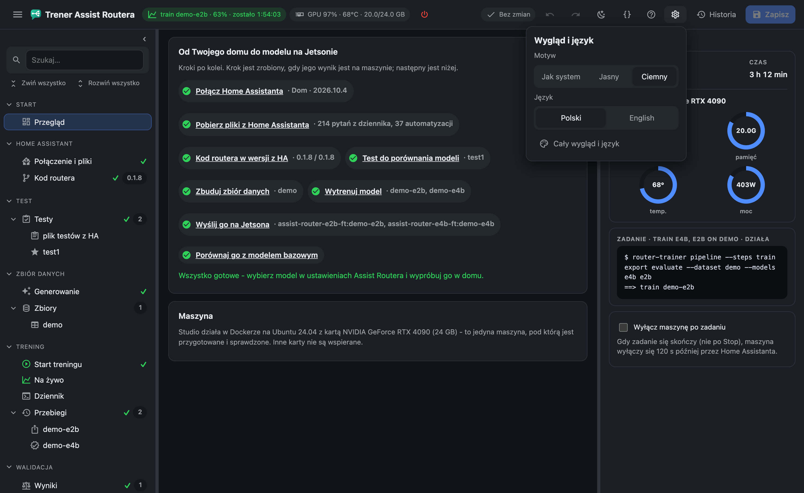

Kolumny można zwinąć (‹ i ›, Ctrl/⌘+B i Ctrl/⌘+Alt+B) i poszerzyć, przeciągając dzielnik.

## Krok 1. Połącz Home Assistanta {#guide-connect}

1. W drzewie: Home Assistant → Połączenie i pliki.
2. Wpisz adres HA z portem (np. `http://homeassistant.local:8123`) i token administratora.
3. Połącz z HA.

Studio pokazuje nazwę domu i wersję HA. Token zostaje na maszynie i nie jest już nigdy pokazywany; pole tokenu
możesz potem zostawić puste. Gdy HA odrzuci token, studio przestaje o cokolwiek pytać HA (każde odrzucenie to dla HA
nieudane logowanie) i czeka na nowy token.

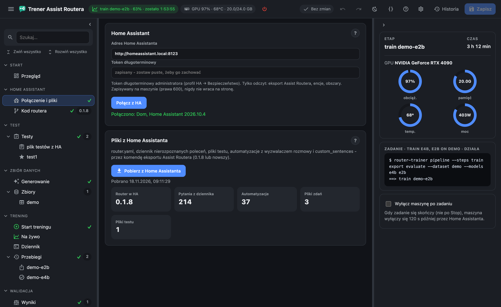

## Krok 2. Pobierz pliki z Home Assistanta {#guide-fetch}

Na tej samej karcie: Pobierz z Home Assistanta. Trwa kilka sekund. Przychodzą:

- `router.yaml`, czyli tematy routera i ich przykłady;
- dziennik nierozpoznanych poleceń (prawdziwe pytania z domu);
- pliki testu z HA, jeśli są;
- każda automatyzacja z wyzwalaczem rozmowy, także z `packages/`;
- pliki `custom_sentences`.

Karta pokazuje liczby: pytania z dziennika, automatyzacje, pliki zdań, pliki testu i wersję routera w HA.
**Pobieraj przed każdym nowym zbiorem**, żeby model uczył się na obecnym stanie domu.

## Krok 3. Kod routera {#guide-router}

Home Assistant → Kod routera. Model uczy się dokładnie tych promptów, które potem dostanie
od Assist Routera, więc studio musi mieć kod routera w tej samej wersji co HA.

- Zielony napis: ta sama wersja, nic nie rób.
- Czerwona pigułka „Router 0.1.7 ≠ HA 0.1.8” w górnym pasku: kliknij Pobierz router {version}.
  Studio pobiera ten tag z GitHuba, bez przebudowy obrazu.
- Gdy nowa wersja potrzebuje innych pakietów Pythona, studio to powie: przebuduj obraz (`make deploy` z Maca).

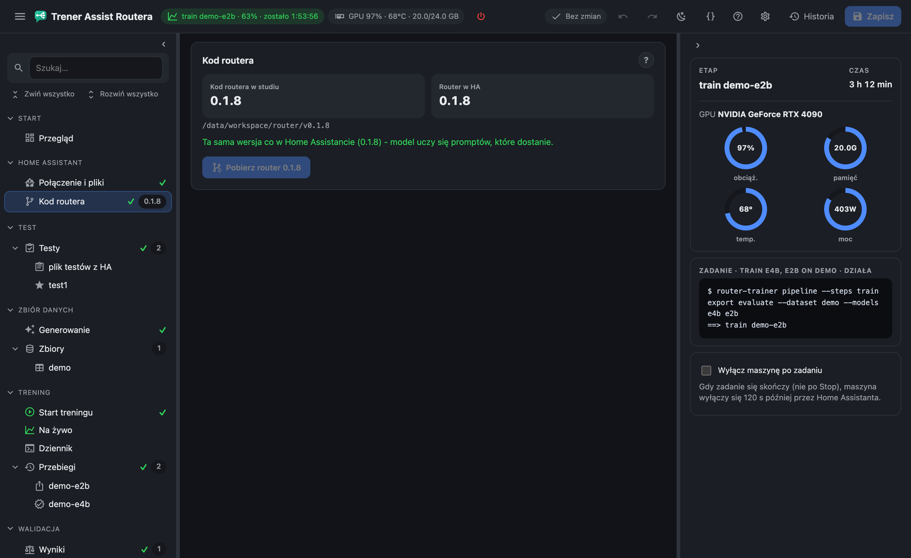

## Krok 4. Test, czyli miara {#guide-test}

Test → Testy. Aktywny test to **jedyna miara** porównania modeli. Jego zdania nigdy nie
trafiają do treningu. Masz dwie możliwości:

- **Plik testów z HA** (`/config/assist/model_test.yaml`), jeśli go prowadzisz. Jest gotowy od razu.
- **Test generowany:** wpisz nazwę (np. `lis18`) i Utwórz test. Model-pisarz (Bielik) pisze
  przypadki z Twojego domu i dziennika, nauczyciel (Gemma 26B) je sprawdza; zostaje tylko to, co oba rozumieją tak
  samo. Trwa około godziny.

Wybierz test i Ustaw jako aktywny test.

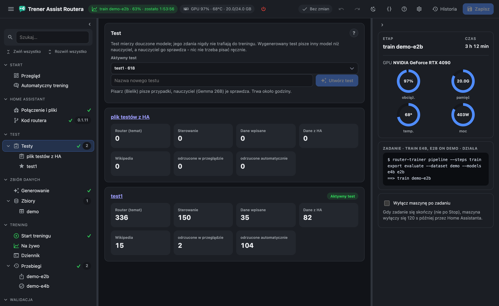

**Przegląd (opcjonalnie):** kliknij test w drzewie i przejrzyj przypadki. Zaznacz te, które wyglądają źle (złe
oczekiwanie, dziwne zdanie); nie będą liczone. Po zmianie aktywnego testu albo przeglądu zbuduj zbiór od nowa
(krok 5), bo zamrożenie testu musi objąć nowe zdania.

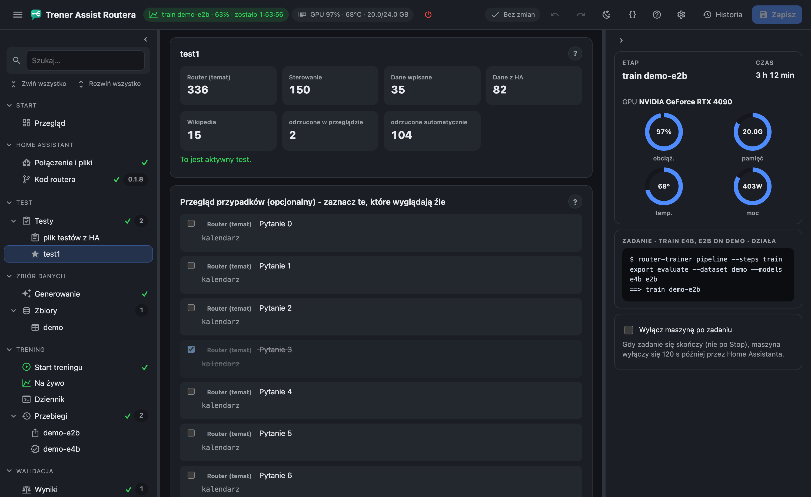

## Krok 5. Zbiór danych {#guide-dataset}

Zbiór danych → Generowanie.

1. **Nazwa zbioru**, najlepiej z datą (`lis18`). Nowa nazwa zostawia stare zbiory do porównań.
2. **Etapy**: domyślnie wszystkie. Każdy można zaznaczyć osobno, np. tylko złożenie zbioru po zmianie ustawień
   podziału.
3. Generuj.

| Etap | Co robi | Czas |
|---|---|---|
| migawka domu | encje, aliasy, obszary, skrypty i sceny z HA | sekundy |
| zamrożenie testu | zapamiętuje zdania testu, żeby nic podobnego nie trafiło do treningu | sekundy |
| router | zdania z Twoich automatyzacji, intencje HA z Twoimi nazwami, parafrazy nauczyciela, pytania o wiedzę, bełkot, pytania z dziennika | najdłużej |
| sterowanie | Python planuje polecenie z Twojego domu, nauczyciel je pisze i rozbiera z powrotem; zostaje tylko zgodne | długo |
| odpowiedzi | wymyślone dane z faktami z Pythona, Twoje dane z HA na żywo, streszczenia z Wikipedii | średnio |
| złożenie zbioru | rozmowy z funkcjami integracji, odrzucenie zdań podobnych do testu, wyrównanie tematów, szum, podział train/dev | minuty |

Całość trwa od godziny do kilku godzin. Postęp jest w górnym pasku i w prawej kolumnie. **Generowanie można
przerwać** (Stop) i uruchomić ponownie: zaczyna od miejsca przerwania.

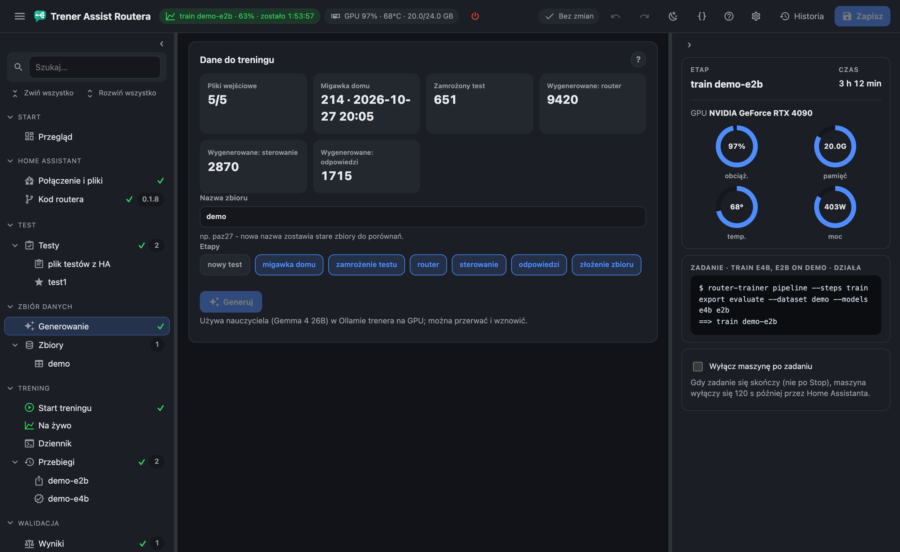

Gotowy zbiór jest w drzewie pod Zbiory. Na co patrzeć:

- **Źródła i tematy:** czy żaden temat nie ma podejrzanie mało przykładów. Mały temat jest dopełniany zaszumionymi
  kopiami; lepiej dopisać mu przykłady w `router.yaml`.
- **Odrzucone jako podobne do testu:** przykłady pokazują, co odpadło. Dużo odrzuconych to znak, że test i dane są
  bardzo podobne. To dobrze dla uczciwości wyniku.
- **Ostrzeżenie o promptach:** „router.yaml albo dom zmieniły się od zbudowania tego zbioru”. Zbuduj zbiór od nowa.

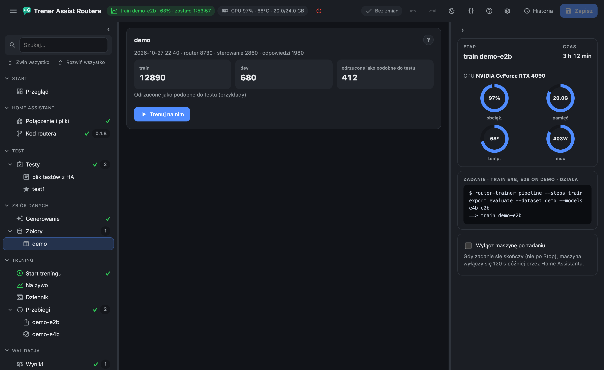

## Krok 6. Trening {#guide-train}

Trening → Start treningu (albo Trenuj na nim na karcie zbioru).

1. **Zbiór** i **modele**: zacznij od E2B (szybki, około godziny), potem E4B z najlepszymi ustawieniami (kilka
   godzin). Oba po kolei mieszczą się w jednej nocy.
2. **Ustawienia tego przebiegu (opcjonalnie):** puste pole = wartość z ustawień (szara). Wpisana wartość dotyczy
   tylko tego przebiegu. Znaczenie każdego parametru: [Parametry](good-practice.md#parameters).
3. potem eksport i test: po treningu od razu eksport na Jetsona i porównanie z modelem
   bazowym. Zostaw zaznaczone, jeśli trenujesz na noc.
4. Wyłącz maszynę po zadaniu: maszyna wyłączy się sama po całym zadaniu
   ([szczegóły](home-assistant.md#power-off-after)).
5. Start.

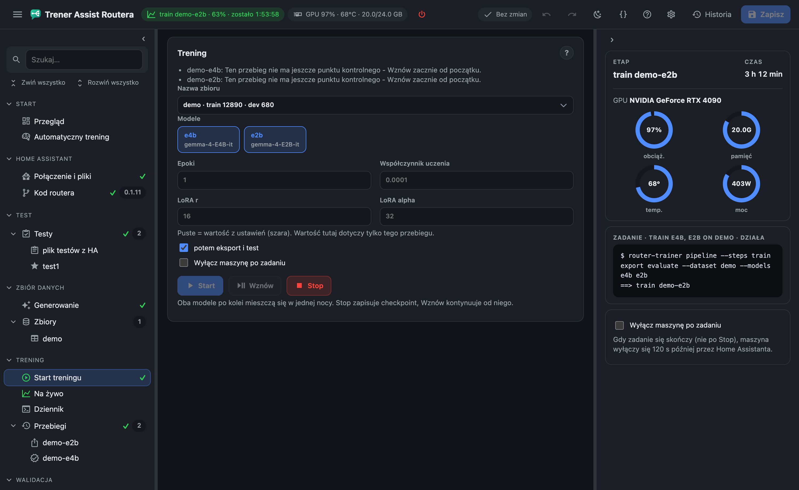

**W trakcie** otwórz Trening → Na żywo: etap, czas do końca, karta i wykres straty.

- Obie straty spadają razem: dobrze.
- Strata dev rośnie, a treningowa spada: model uczy się na pamięć. Studio ostrzega po dwóch wzrostach z rzędu.
  Zatrzymaj i zmniejsz epoki albo learning rate.
- „Pominięte (za długie)”: przykłady dłuższe niż `max_seq_length`.

Więcej: [Czytanie wykresu](good-practice.md#chart).

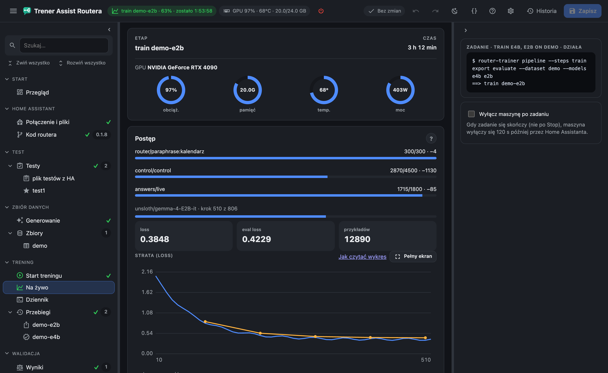

**Stop i Wznów:** Stop zapisuje punkt kontrolny. Wznów z tym samym
zbiorem i modelem kontynuuje od niego, a karta mówi, ile kroków naprawdę zostało. Po restarcie maszyny zadanie jest
oznaczone jako przerwane; wznowisz je tak samo.

**Dziennik:** Trening → Dziennik ma każde zadanie z czasem startu, czasem trwania, wynikiem
i pełnym logiem.

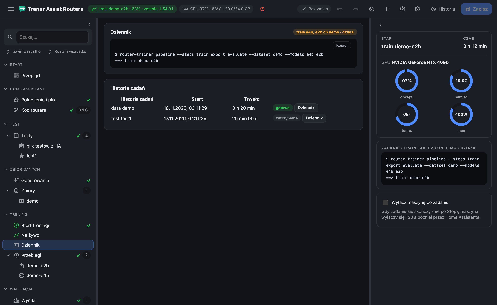

## Krok 7. Eksport na Jetsona {#guide-export}

Trening → Przebiegi → wybierz przebieg → Eksportuj (pomiń, jeśli
zaznaczyłeś „potem eksport i test”).

Co się dzieje:

1. wagi są łączone z adapterem i zapisywane jako GGUF (q8_0, prawie bez strat);
2. Ollama studia odpowiada na kilka zdań, żeby sprawdzić, czy model w ogóle działa;
3. model trafia do Ollamy na Jetsonie jako `assist-router-<model>-ft:<przebieg>`, np.
   `assist-router-e2b-ft:lis18-e2b`, po sprawdzeniu, czy zmieści się obok załadowanych modeli.

Nic się w domu jeszcze nie zmienia: Assist Router dalej używa starego modelu, dopóki go nie przełączysz (krok 9).

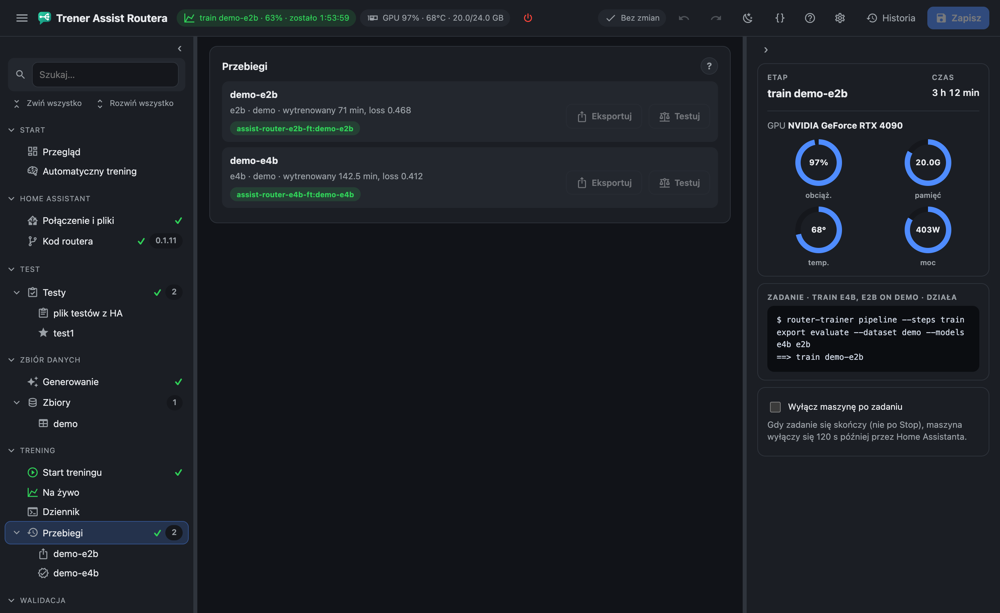

## Krok 8. Porównaj z modelem bazowym {#guide-validate}

Na karcie przebiegu Testuj, potem Walidacja → Wyniki. Aktywny test
działa dla douczonego i bazowego modelu w Ollamie na Jetsonie, w pięciu częściach: router, sterowanie, dane
wpisane, dane z HA i Wikipedia.

- zielone ≥ 95%, żółte ≥ 85%, czerwone poniżej;
- **naprawione** i **zepsute** mówią więcej niż sam wynik; zepsute pokazują, czego model się oduczył;
- liczy się też czas (sekundy obok wyniku), bo po to jest mniejszy model.

Model jest lepszy, gdy wygrywa w routerze i sterowaniu **i** nie traci w odpowiedziach.
[Jak czytać wyniki](good-practice.md#results).

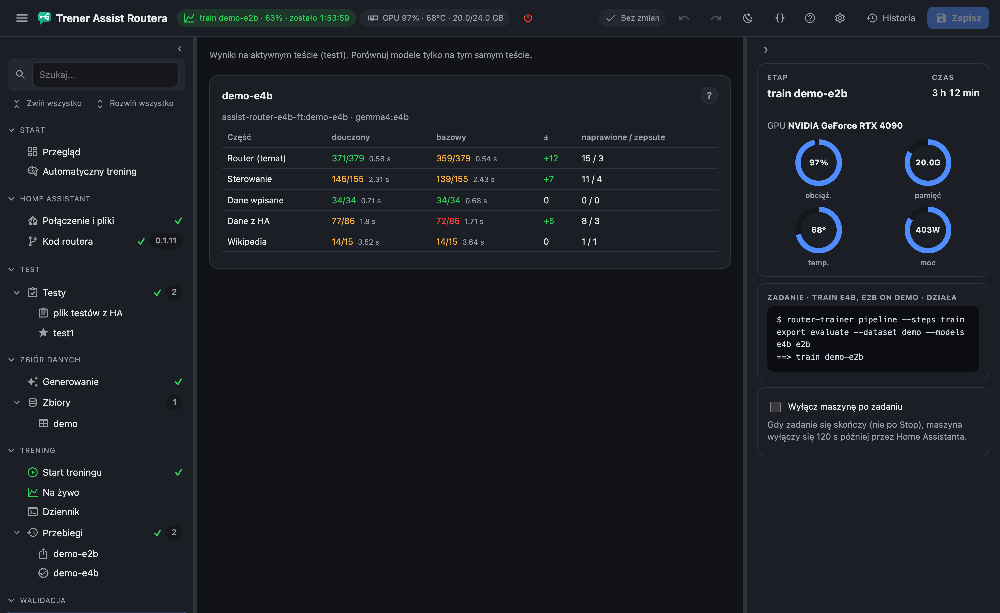

**Wypróbuj:** Walidacja → Wypróbuj. Wpisz jedno zdanie (np. „Wyłącz światło w kuchni”),
zaznacz modele i Sprawdź. Widzisz temat, plan sterowania albo odpowiedź każdego modelu obok
siebie. Nic nie wykonuje się w domu.

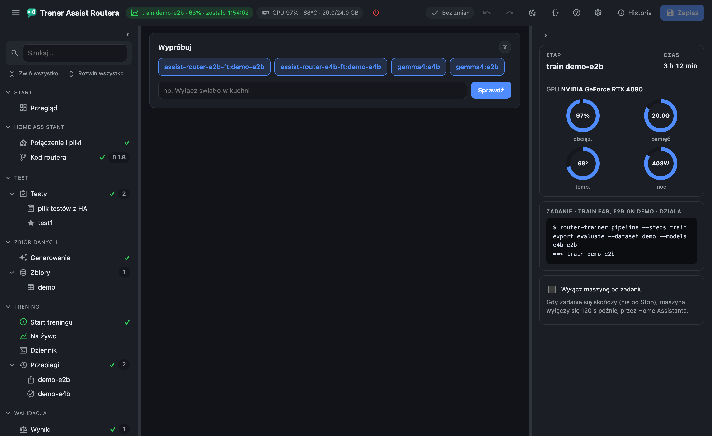

## Krok 9. Używaj go w domu {#guide-home}

1. Home Assistant → Ustawienia → Urządzenia i usługi → Assist Router → Konfiguruj → **Router pytań**.
2. W polu **Model routera** wybierz nowy model z Ollamy na Jetsonie (`assist-router-…-ft:…`). Douczony model
   uczył się też odpowiedzi, więc możesz go wybrać również w polu **Model odpowiedzi**. Zrób to wtedy, gdy wyniki
   odpowiedzi w kroku 8 nie są gorsze od bazowych.
3. Rozmawiaj jak zwykle i obserwuj dziennik nierozpoznanych poleceń.

Powrót jest prosty: wybierz poprzedni model. Stare modele zostają w Ollamie, dopóki ich nie usuniesz.

## Ustawienia, szkic i historia {#guide-settings}

Ustawienia → `trainer.yaml` to wszystkie ustawienia studia w formularzach: Ollama i modele, generowanie, test
generowany, zamrożony test, zbiór danych, eksport, ocena i każdy model osobno.

- Każda zmiana trafia do **szkicu** na maszynie. Nic się nie zmienia do Zapisz.
- Prawa kolumna pokazuje YAML wybranej części; YAML w górnym pasku pokazuje cały plik.
  Formularz i tekst trafiają do tego samego szkicu.
- Zapisz pokazuje zmienione linie i przyjmuje notatkę.
- Historia trzyma 30 wersji; przywrócenie robi z wersji szkic.
- Skróty: Ctrl/⌘+S zapis, Ctrl/⌘+Z cofnij, Ctrl/⌘+Shift+Z ponów.

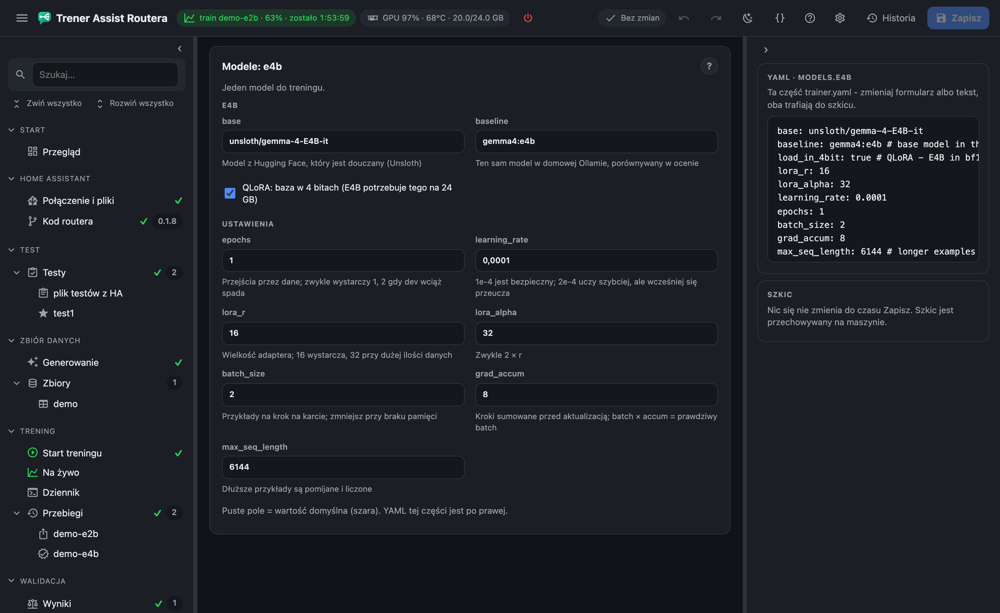

Ustawienia → Wygląd i język ma te same wybory co okienko ⚙.

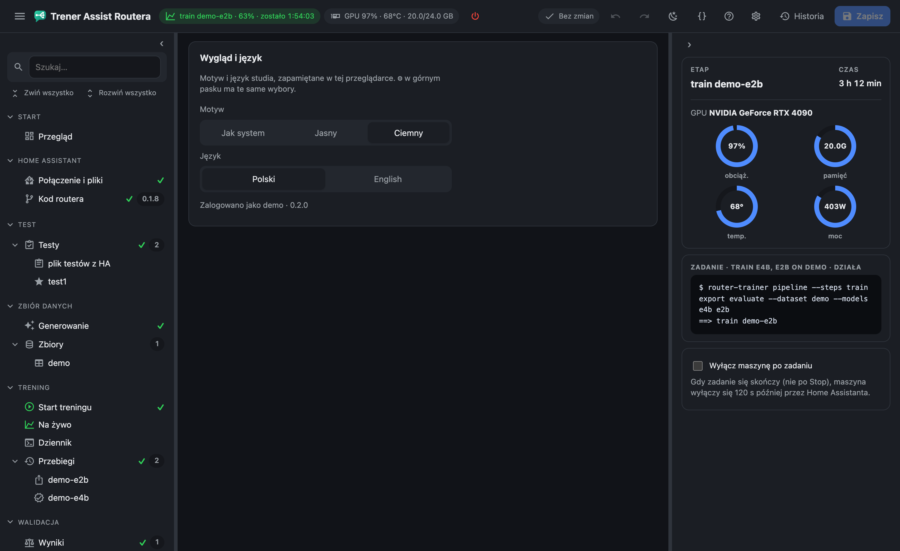

## Maszyna, zasilanie i konto {#guide-machine}

- **Zasilanie maszyny:** przełącznik maszyny w HA i czujnik mocy gniazdka, Zapisz zasilanie.
  Przycisk ⏻ w górnym pasku wyłącza maszynę bezpiecznie (system, potem gniazdko); jest zablokowany w trakcie
  zadania. Studio nie umie włączyć maszyny; robi to Home Assistant.
- **Sprawdzenie maszyny:** Sprawdź pokazuje kartę, sterownik, wolne miejsce, środowiska i
  Ollamę studia w kontenerze.
- **Konto:** kto jest zalogowany i jak zmienić hasło (w `docker/config/env` na maszynie).

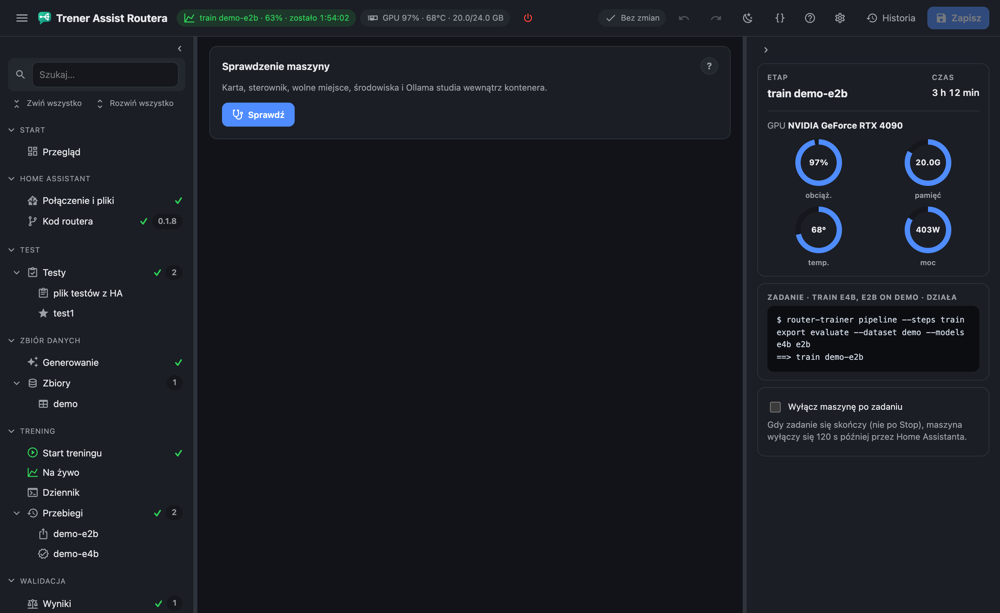

## Kolejne rundy {#guide-next}

1. Pobierz pliki z HA i sprawdź kod routera.
2. Zmień **jedną rzecz naraz** (parametr albo dane).
3. Nowy zbiór pod nową nazwą, trening, eksport, porównanie **na tym samym teście**.
4. Zatrzymaj najlepszy przebieg, resztę usuń z Ollamy na Jetsonie.

Przepisy na typowe problemy: [Przepisy](good-practice.md#recipes). Komunikaty błędów i ich rozwiązania:
[FAQ](faq.md#faq).

## Szybka próba całej drogi {#guide-smoke}

Po instalacji albo aktualizacji sprawdź całą drogę na małej kopii danych, bez ruszania prawdziwego workspace:
`make docker-shell` na maszynie, potem `router-trainer smoke`. Trwa 15-25 minut: mały test, mały zbiór, pół epoki
E2B, eksport, porównanie z modelem bazowym i usunięcie modelu próby z Jetsona. Kończy się linią
„smoke test passed”.
