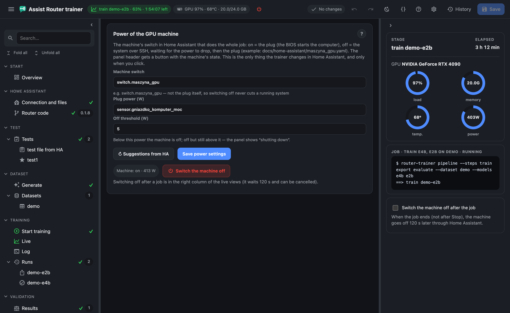

# Home Assistant and power {#home-assistant}

## The token {#token}

An **administrator's** long-lived token (HA profile → Security). It is needed because the router's files are
handed over only by Assist Router's read-only export command, which is for administrators; the studio **changes
nothing** in Home Assistant, except the machine's switch when you set it. The token is in the workspace
(mode 600), never in a log or an API answer. A token HA rejects (401) is remembered and HA is not asked again
until Connect to HA - every 401 is a failed login for HA's `ip_ban`.

## Machine power {#power}

**Settings → Machine power**: the machine's switch in Home Assistant (e.g. `switch.maszyna_gpu`) and the plug's
power sensor; Save power settings. Switch the machine off =
`switch.turn_off` on that switch: Home Assistant shuts the system down over SSH, then cuts the plug (package
`docs/home-assistant/maszyna_gpu.yaml`). The container never runs `poweroff` itself, and never switches off
during a job. The studio cannot switch the machine on - Home Assistant does that.

## Switching off after the job {#power-off-after}

Switch the machine off after the job (right column and the start card; off by default,
cleared once used):

- after the job ends - **successfully or with an error** - a 120 s countdown in the top bar, with
  Cancel;
- **not** after Stop;
- training → export → evaluation is one job: the machine goes off after the last step; a job started by hand during
  the countdown holds it;
- a container restart during the countdown does not switch the machine off (the countdown is lost);
- an error (no token, switch unavailable) shows in the top bar.
