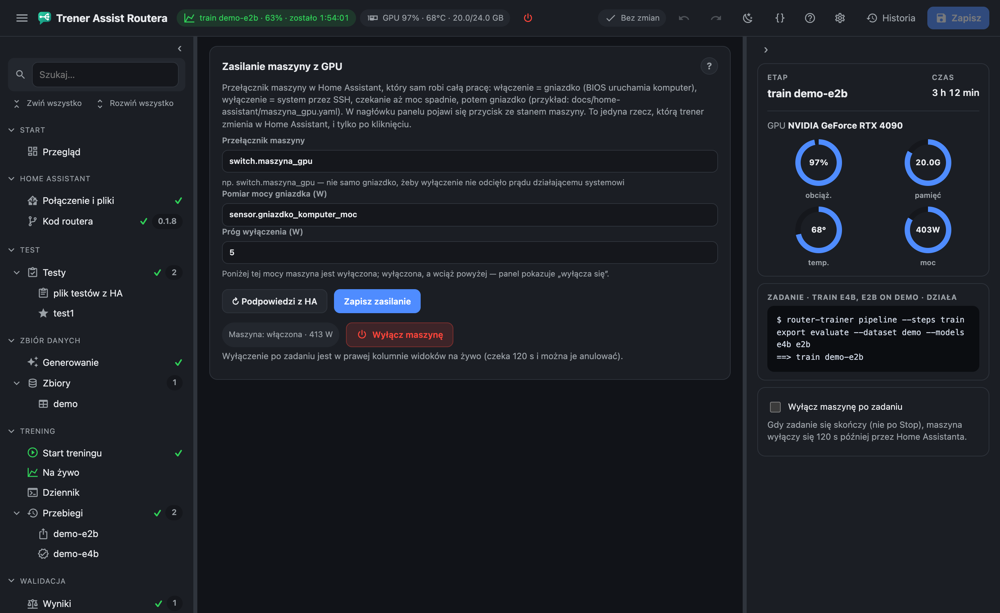

# Home Assistant i zasilanie {#home-assistant}

## Token {#token}

Długoterminowy token **administratora** (profil HA → Bezpieczeństwo). Jest potrzebny, bo pliki routera wydaje
tylko komenda eksportu Assist Routera (tylko odczyt), przeznaczona dla administratorów; studio **niczego nie
zmienia** w Home Assistancie poza przełącznikiem maszyny, gdy go ustawisz. Token leży w workspace (prawa 600),
nigdy w dzienniku ani w odpowiedzi API. Token odrzucony przez HA (401) jest zapamiętany i HA nie jest pytany do
czasu Połącz z HA - każde 401 to dla HA nieudane logowanie (`ip_ban`).

## Zasilanie maszyny {#power}

**Ustawienia → Zasilanie maszyny**: przełącznik maszyny w Home Assistancie (np. `switch.maszyna_gpu`) i czujnik
mocy gniazdka; Zapisz zasilanie. Wyłącz maszynę =
`switch.turn_off` na tym przełączniku: Home Assistant wyłącza system przez SSH, potem odcina gniazdko (pakiet
`docs/home-assistant/maszyna_gpu.yaml`). Kontener nigdy sam nie robi `poweroff` i nigdy nie wyłącza maszyny w
trakcie zadania. Studio nie umie włączyć maszyny - robi to Home Assistant.

## Wyłączenie po zadaniu {#power-off-after}

Wyłącz maszynę po zadaniu (prawa kolumna i karta startu; domyślnie wyłączone, kasuje się
po użyciu):

- po końcu zadania - **udanym albo z błędem** - odliczanie 120 s w górnym pasku z Anuluj;
- **nie** po Stop;
- trening → eksport → ocena to jedno zadanie: maszyna wyłączy się po ostatnim kroku; zadanie uruchomione ręcznie
  w trakcie odliczania wstrzymuje je;
- restart kontenera w trakcie odliczania nie wyłącza maszyny (odliczanie przepada);
- błąd (brak tokenu, przełącznik niedostępny) pokazuje się w górnym pasku.
