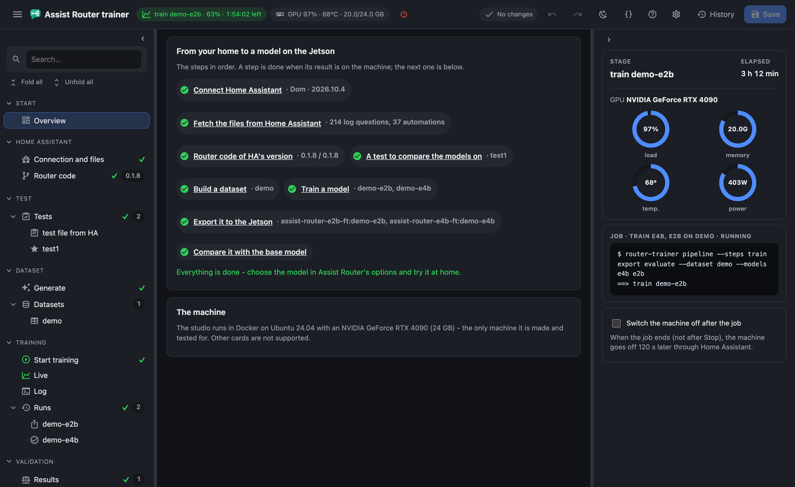

# Assist Router trainer {#what}

A studio on the GPU machine that fine-tunes a **smaller model** (Gemma 4 E2B or E4B) on **your home's data** -
your rooms, devices, automations and questions. The trained model runs in Ollama on the Jetson and helps Assist
Router understand voice commands faster and better. Everything happens in the browser.



## What the model learns {#roles}

Assist Router uses a language model in three roles. A big model (e.g. Gemma 4 26B) does them well but is slow and
takes much of the Jetson's memory; a small model is fast but does not know your home. The trainer teaches a small
model exactly what the integration gives it:

| Role | The model gets | The model answers |
|---|---|---|
| Router | a prompt with the topics and examples of `router.yaml` + the question | `{"temat": "kalendarz"}` |
| Control | the parser's prompt with your areas, domains, scripts and scenes + the command | JSON: intent, area, device, value… |
| Answers | data from Home Assistant or a Wikipedia article + the question | a short answer to read aloud |

The prompts are **not copied**: the studio imports them from the Assist Router code of the version your Home
Assistant runs, so the model learns exactly what it will get.

## The road {#flow}

```
Home Assistant ──(export command, read only)──► inputs ─► home snapshot ─► frozen test
      ▲                                                        │
      │                                     teacher (Gemma 26B) writes examples
      │                                                        ▼
 Assist Router ◄── Ollama on the Jetson ◄── export (GGUF) ◄── training (Unsloth) ◄── dataset
      │                                          │
      └──────────── validation: the same test for the trained and the base model
```

## Hardware and support {#hardware}

!!! warning "One machine only"
    The studio is made and tested for **exactly one** setup: **Ubuntu 24.04 with an NVIDIA GeForce RTX 4090
    (24 GB)**, driver 580 / CUDA 13.0, in Docker. The image (PyTorch, Unsloth, batch sizes, QLoRA for E4B) is
    chosen for this card. The project will not be adapted to other cards or machines - anyone may use it, but
    supporting other hardware is up to you. A Mac only runs the demo, the tests and this guide.

Next: [Installation](installation.md).
