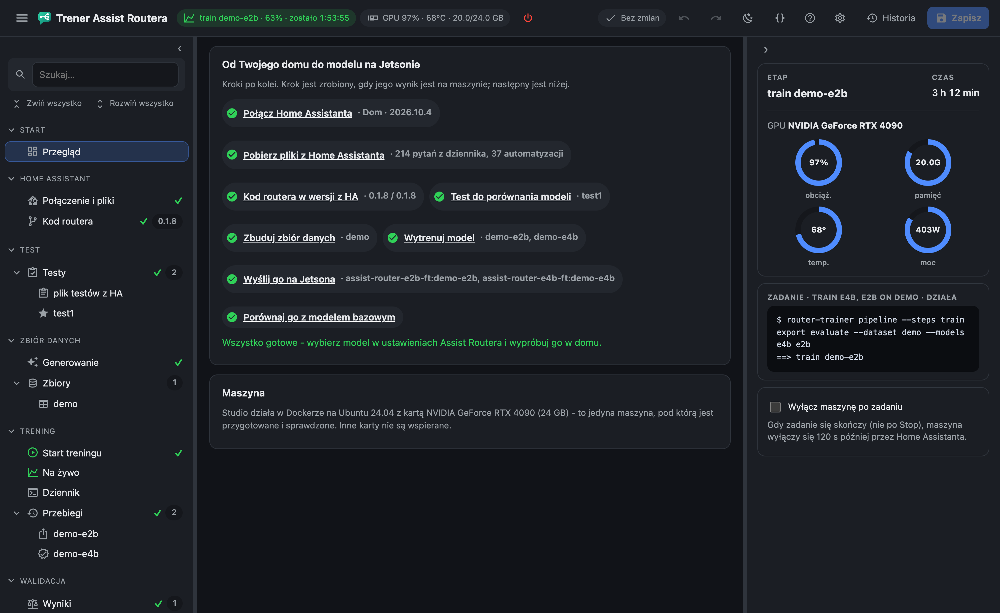

# Trener Assist Routera {#what}

Studio na maszynie z GPU, które douczy **mniejszy model** (Gemma 4 E2B albo E4B) na **danych Twojego domu** -
pokojach, urządzeniach, automatyzacjach i pytaniach. Wyuczony model działa w Ollamie na Jetsonie i pomaga Assist
Routerowi szybciej i lepiej rozumieć polecenia głosowe. Wszystko robisz w przeglądarce.



## Czego uczy się model {#roles}

Assist Router używa modelu językowego w trzech rolach. Duży model (np. Gemma 4 26B) robi to dobrze, ale jest wolny
i zajmuje dużo pamięci Jetsona; mały jest szybki, ale nie zna Twojego domu. Trener uczy mały model dokładnie tego,
co dostaje od integracji:

| Rola | Model dostaje | Model odpowiada |
|---|---|---|
| Router | prompt z tematami i przykładami z `router.yaml` + pytanie | `{"temat": "kalendarz"}` |
| Sterowanie | prompt parsera z Twoimi obszarami, domenami, skryptami i scenami + polecenie | JSON: intencja, obszar, urządzenie, wartość… |
| Odpowiedzi | dane z Home Assistanta albo artykuł z Wikipedii + pytanie | krótka odpowiedź do przeczytania na głos |

Prompty **nie są kopiowane**: studio importuje je z kodu Assist Routera w wersji, którą ma Twój Home Assistant,
więc model uczy się dokładnie tego, co potem dostanie.

## Droga {#flow}

```
Home Assistant ──(komenda eksportu, tylko odczyt)──► pliki ─► migawka domu ─► zamrożony test
      ▲                                                            │
      │                                      nauczyciel (Gemma 26B) pisze przykłady
      │                                                            ▼
 Assist Router ◄── Ollama na Jetsonie ◄── eksport (GGUF) ◄── trening (Unsloth) ◄── zbiór danych
      │                                          │
      └──────────── walidacja: ten sam test dla douczonego i bazowego modelu
```

## Sprzęt i wsparcie {#hardware}

!!! warning "Tylko jedna maszyna"
    Studio jest zrobione i sprawdzone na **dokładnie jednym** zestawie: **Ubuntu 24.04 z NVIDIA GeForce RTX 4090
    (24 GB)**, sterownik 580 / CUDA 13.0, w Dockerze. Obraz (PyTorch, Unsloth, rozmiary paczek, QLoRA dla E4B)
    jest dobrany pod tę kartę. Projekt nie będzie dostosowywany do innych kart ani maszyn - każdy może z niego
    korzystać, ale obsługa innego sprzętu jest po Twojej stronie. Mac uruchamia tylko demo, testy i ten przewodnik.

Dalej: [Instalacja](installation.md).
