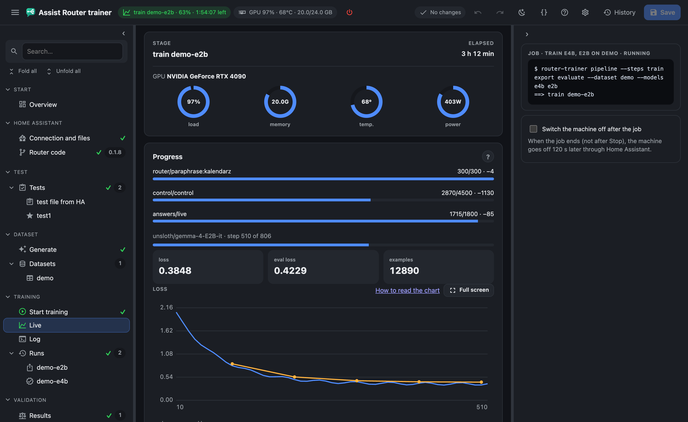

# Installation {#installation}

## Try it on a Mac {#try-on-a-mac}

1. **Needed:** only [Docker Desktop](https://www.docker.com/products/docker-desktop/), running. No GPU, Python or
   Home Assistant.
2. **One command:** `make demo` (it builds the demo image first: under a minute, after that seconds).
3. **Open** http://localhost:8791 and log in as `demo` / `demo`.
4. **Pretend:** a made-up home, a pretend GPU and Home Assistant, all inside the container; nothing goes to a real
   Home Assistant or to the machine. Ctrl+C stops and removes the container; `make demo-clean` removes the image.
5. **Guide and development:** `make docs` builds the guide in Docker and opens it. `make test` and
   `make test-browser` need the environment of `make setup` ([uv](https://docs.astral.sh/uv/), which brings the
   Python of the `Makefile` itself; the Assist Router repository next to this one; Chrome for the browser tests).

## What is needed {#requirements}

- The GPU machine: Ubuntu 24.04, NVIDIA driver 580, Docker with the Compose plugin, NVIDIA Container Toolkit,
  about 200 GB free (the image ~25 GB, base models, checkpoints, teacher models).
- Home Assistant with **Assist Router 0.1.8 or newer** (its read-only export command for the trainer) and an
  **administrator's** long-lived token.
- Ollama on the Jetson (the trained model goes there and the evaluation runs there).
- The machine is switched on by Home Assistant (`switch.maszyna_gpu`); install only when it is on.

## From the Mac {#install-mac}

The address of the machine is shared by all studios (wake word, Piper Voice Cloner, this one) and kept outside
the repositories:

```bash
mkdir -p ~/.config/gpu-studio
echo 'GPU_HOST = user@192.168.1.21' > ~/.config/gpu-studio/host.mk
```

`Makefile.local` (not in git) can override this studio only, e.g. `GPU_DIR = other-folder`. Then:

```bash
make install     # code to the machine (rsync) + docker/install-ubuntu.sh there
make login       # the studio's user and password
make status      # does it answer, the card in the container, the version
make logs        # the studio's log (Ctrl+C ends)
```

`docker/install-ubuntu.sh`:

1. checks Docker, Compose, the permissions, the driver, the NVIDIA toolkit and the free disk (missing parts:
   the exact commands to paste);
2. switches off the old panel service of this studio (systemd, the same port);
3. on the first run writes the login to `docker/config/env` (`ROUTER_TRAINER_UI_AUTH=admin:<random>`, mode 600);
4. starts Docker with the machine;
5. builds the image (the first time ~20 GB: PyTorch, CUDA, Unsloth, Home Assistant, Ollama, llama.cpp) and starts
   the container;
6. checks that the container sees the card and prints the address, e.g. `http://192.168.1.21:8790/`.



## On the machine itself {#install-machine}

A repository cloned on the machine installs without the Mac: `./docker/install-ubuntu.sh`; updates:
`git pull && make docker-up`. Other targets there: `make docker-logs`, `docker-down`, `docker-shell`.

## No login on the home network {#trusted-networks}

A home that uses the machine only on its own network can skip the login there. Give the network once when
installing:

```bash
make install STUDIO_TRUSTED_NETWORKS=192.168.1.0/24    # your home network, several: comma-separated
make install STUDIO_TRUSTED_NETWORKS=                  # the login from everywhere again
```

- The line `STUDIO_TRUSTED_NETWORKS=…` goes to `docker/config/env` (mode 600); `make install` without it keeps
  what is there. The same name works in every studio on the GPU machine.
- Only the address of the connection counts, never a header such as `X-Forwarded-For`.
- VPN clients count when the VPN translates their address to a home address.
- From such a network the studio opens without the login page, and ☰ shows
  "No login needed — this network is trusted (STUDIO_TRUSTED_NETWORKS)." instead of the log-out button.
- A machine in the cloud leaves it empty and keeps the login.

## Where the data is {#data-folders}

| Folder | What |
|---|---|
| `docker/data/workspace` | inputs from HA, tests, datasets, runs (checkpoints, GGUF), the trainer's Ollama models |
| `docker/data/huggingface` | downloaded base models (can be lost - downloaded again) |
| `docker/config` | the login (`env`), the session secret (mode 600) |

Another place for the data: `STUDIO_DATA=/mnt/big/router-trainer ./docker/install-ubuntu.sh` (kept in
`docker/.env`).

## Updating {#update}

From the Mac: `make deploy` (code to the machine, `docker compose up -d --build`). A rebuild takes seconds - the
environments are a layer of their own. **A container restart stops a running job**; resume training from its
checkpoint (<span class="ui">Resume</span>).

## Backup and access from outside {#backup}

Backup = `docker/data/workspace` + `docker/config`. From outside the home only through the VPN (WireGuard); the
port is never exposed to the internet.

## From the old setup {#migrate}

```bash
make migrate          # (on the machine) copies ~/assist-router-trainer/trainer/workspace to docker/data/workspace
make migrate-finish   # switches the old panel service off (install-ubuntu.sh does it too)
```
