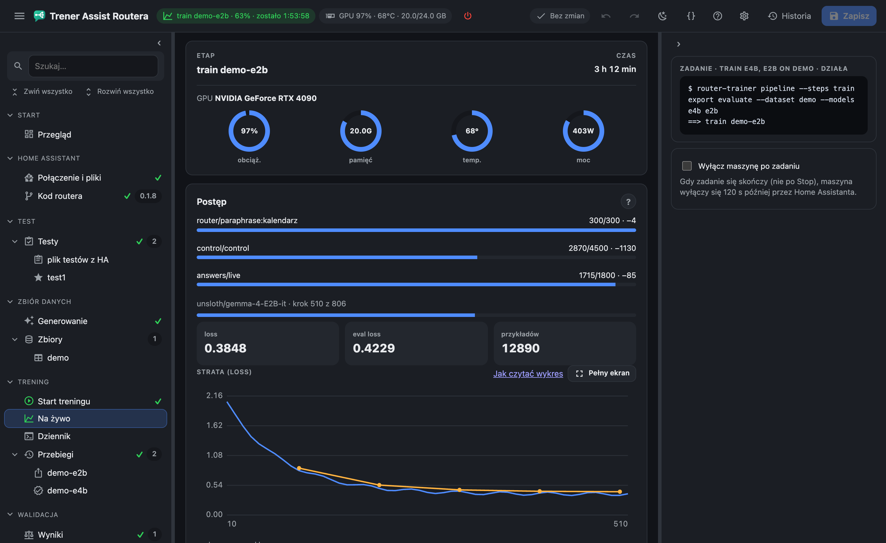

# Instalacja {#installation}

## Wypróbuj na Macu {#try-on-a-mac}

1. **Potrzebne:** tylko [Docker Desktop](https://www.docker.com/products/docker-desktop/), uruchomiony. Bez GPU,
   Pythona i Home Assistanta.
2. **Jedno polecenie:** `make demo` (najpierw buduje obraz demo: poniżej minuty, potem sekundy).
3. **Otwórz** http://localhost:8791 i zaloguj się jako `demo` / `demo`.
4. **Udawane:** wymyślony dom, udawane GPU i Home Assistant, wszystko w kontenerze; nic nie trafia do prawdziwego
   Home Assistanta ani na maszynę. Ctrl+C zatrzymuje i usuwa kontener; `make demo-clean` usuwa obraz.
5. **Przewodnik i dla programisty:** `make docs` buduje przewodnik w Dockerze i go otwiera. `make test` i
   `make test-browser` potrzebują środowiska z `make setup` ([uv](https://docs.astral.sh/uv/), który sam pobiera
   Pythona w wersji z `Makefile`; repozytorium Assist Routera obok tego; Chrome do testów w przeglądarce).

## Co jest potrzebne {#requirements}

- Maszyna z GPU: Ubuntu 24.04, sterownik NVIDIA 580, Docker z wtyczką Compose, NVIDIA Container Toolkit,
  ok. 200 GB wolnego miejsca (obraz ~25 GB, modele bazowe, punkty kontrolne, modele nauczyciela).
- Home Assistant z **Assist Routerem 0.1.8 lub nowszym** (jego komenda eksportu dla trenera, tylko odczyt) i
  długoterminowy token **administratora**.
- Ollama na Jetsonie (tam trafia wyuczony model i tam działa ocena).
- Maszynę włącza Home Assistant (`switch.maszyna_gpu`); instaluj tylko, gdy jest włączona.

## Z Maca {#install-mac}

Adres maszyny jest wspólny dla wszystkich studiów (wake word, Piper Voice Cloner, to studio) i leży poza
repozytoriami:

```bash
mkdir -p ~/.config/gpu-studio
echo 'GPU_HOST = user@192.168.1.21' > ~/.config/gpu-studio/host.mk
```

`Makefile.local` (poza gitem) może nadpisać ustawienia tylko tego studia, np. `GPU_DIR = inny-folder`. Potem:

```bash
make install     # kod na maszynę (rsync) + tam docker/install-ubuntu.sh
make login       # użytkownik i hasło studia
make status      # czy odpowiada, karta w kontenerze, wersja
make logs        # dziennik studia (Ctrl+C kończy)
```

`docker/install-ubuntu.sh`:

1. sprawdza Dockera, Compose, uprawnienia, sterownik, toolkit NVIDIA i wolne miejsce (brakujące części: dokładne
   komendy do wklejenia);
2. wyłącza starą usługę panelu tego studia (systemd, ten sam port);
3. przy pierwszym uruchomieniu zapisuje login do `docker/config/env` (`ROUTER_TRAINER_UI_AUTH=admin:<losowe>`,
   prawa 600);
4. włącza start Dockera razem z maszyną;
5. buduje obraz (za pierwszym razem ~20 GB: PyTorch, CUDA, Unsloth, Home Assistant, Ollama, llama.cpp) i
   uruchamia kontener;
6. sprawdza, czy kontener widzi kartę, i wypisuje adres, np. `http://192.168.1.21:8790/`.



## Na samej maszynie {#install-machine}

Repozytorium sklonowane na maszynie instaluje się bez Maca: `./docker/install-ubuntu.sh`; aktualizacja:
`git pull && make docker-up`. Inne cele tam: `make docker-logs`, `docker-down`, `docker-shell`.

## Gdzie są dane {#data-folders}

| Folder | Co |
|---|---|
| `docker/data/workspace` | pliki z HA, testy, zbiory, przebiegi (punkty kontrolne, GGUF), modele Ollamy trenera |
| `docker/data/huggingface` | pobrane modele bazowe (można stracić - pobiorą się znowu) |
| `docker/config` | login (`env`), sekret sesji (prawa 600) |

Inne miejsce na dane: `STUDIO_DATA=/mnt/big/router-trainer ./docker/install-ubuntu.sh` (zapamiętane w
`docker/.env`).

## Aktualizacja {#update}

Z Maca: `make deploy` (kod na maszynę, `docker compose up -d --build`). Przebudowa trwa sekundy - środowiska są
osobną warstwą. **Restart kontenera przerywa trwające zadanie**; trening wznów od punktu kontrolnego
(<span class="ui">Wznów</span>).

## Kopia zapasowa i dostęp z zewnątrz {#backup}

Kopia = `docker/data/workspace` + `docker/config`. Spoza domu tylko przez VPN (WireGuard); port nigdy nie jest
wystawiony do internetu.

## Ze starej instalacji {#migrate}

```bash
make migrate          # (na maszynie) kopiuje ~/assist-router-trainer/trainer/workspace do docker/data/workspace
make migrate-finish   # wyłącza starą usługę panelu (install-ubuntu.sh też to robi)
```
