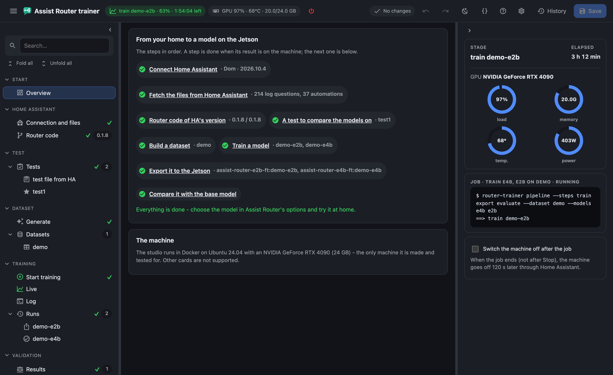
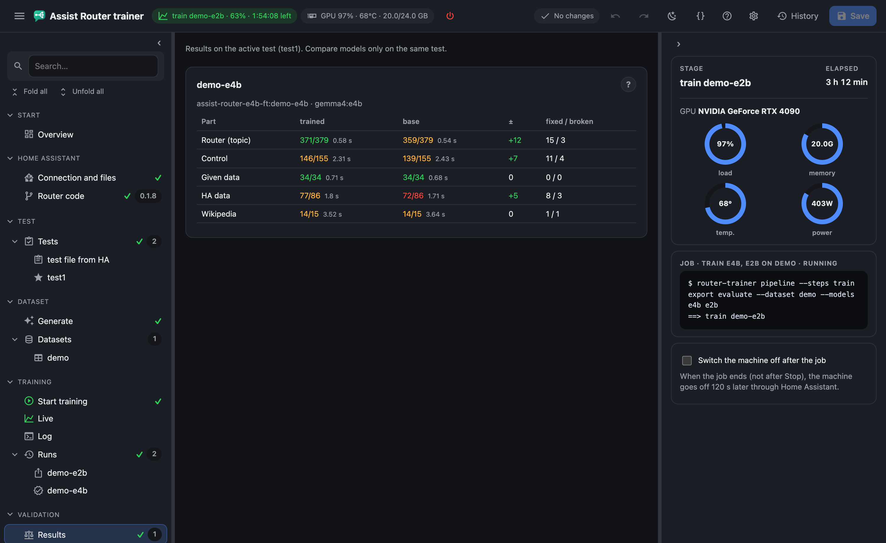
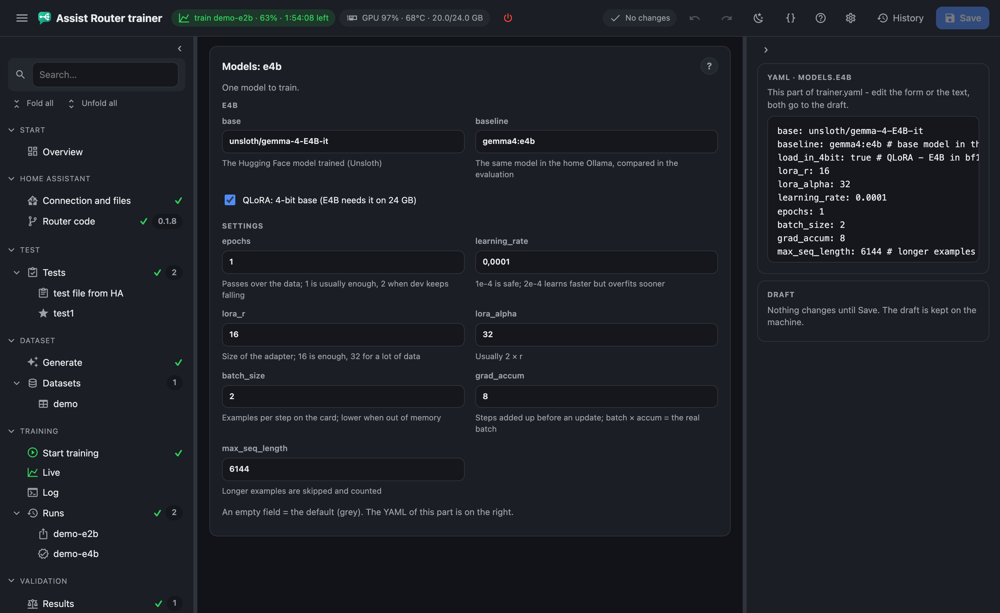
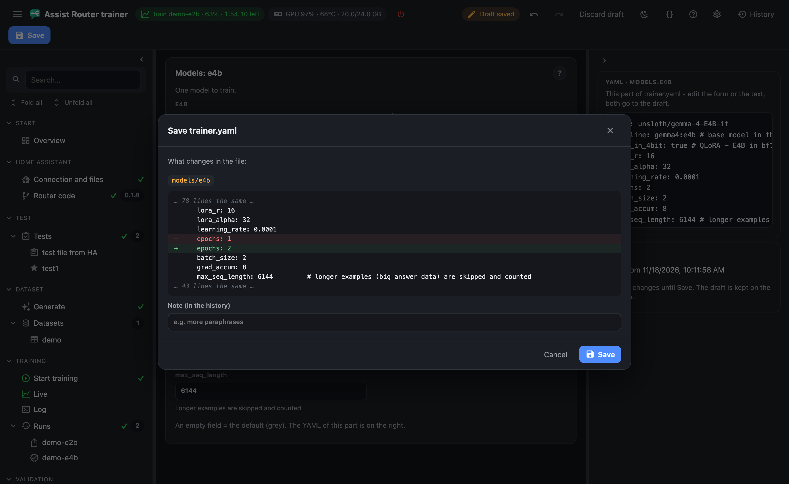

# The screen {#screen}

The studio looks and works like the Home Dashboard and Assist Router editors and the other GPU studios.

## The top bar {#top-bar}

From the left: the ☰ menu (the guide, who is logged in, Log out), the name; the running
job (stage, progress) and the machine (GPU load, temperature, memory, power) with Switch the
machine off; the countdown "switching off in 1:45 · Cancel" and its errors; a red pill when the router code
differs from Home Assistant's; the draft state, undo / redo, Discard draft; the look,
YAML, **?** (this guide in a new tab), ⚙ (a small window with the theme and the language, [described here](guide.md#guide-screen)), History,
Save.

## The tree {#tree}

The steps in working order - Start, Home Assistant, Test, Dataset, Training, Validation - then the settings. A ✓
marks a done step, a number counts tests, datasets and runs, ⚠ shows a problem (a token rejected, router code
of another version, a dataset built with other prompts). Search and folding stay in the browser.

## The columns {#columns}

- **middle** - the view of the chosen item; every card has one **?**: a small popup with what that card does and a
  quiet link to its part of this guide (✕, Esc or a click beside it closes it). Only the **?** in the top bar opens
  this guide;
- **right** - live: stage, time, the card's rings, the job's last lines and
  Switch the machine off after the job; in the settings - the YAML of the chosen part.

‹ at the top of the left column and › at the top of the right one fold them to a narrow bar (Ctrl/⌘+B the left,
Ctrl/⌘+Alt+B the right); the browser remembers it, and an unfolded column gets its width back. In a window narrower
than 900 px the right column starts folded.

## Settings, the draft and the history {#draft}

The settings are `trainer.yaml` as forms. Every change goes to a **draft kept on the machine** (it survives closing
the browser and a restart) - nothing changes until Save. A changed field replaces only its
value in the text, so the file's comments and their alignment stay: one field = one line in the diff. Saving shows
the changed parts and lines and takes a note; when the file changed elsewhere, Save anyway.
The History keeps 30 versions; restoring makes a version the draft. Shortcuts: Ctrl/⌘+S,
Ctrl/⌘+Z, Ctrl/⌘+Shift+Z.

