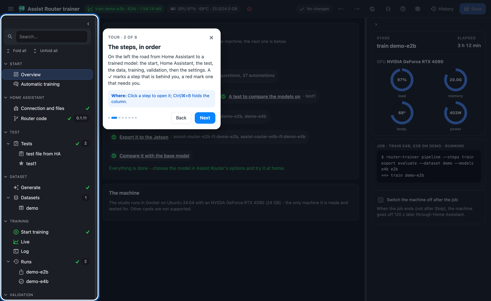
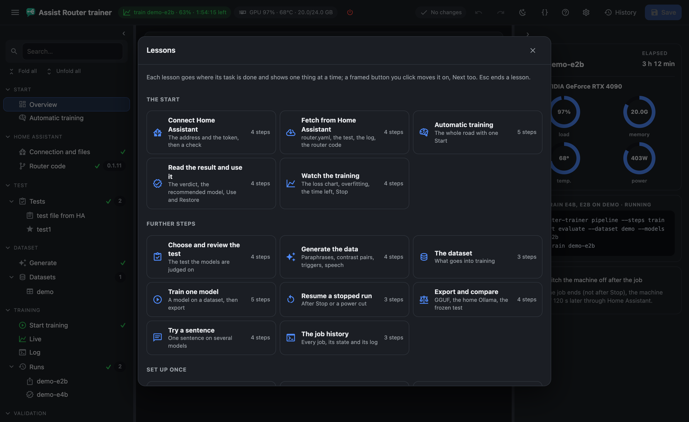
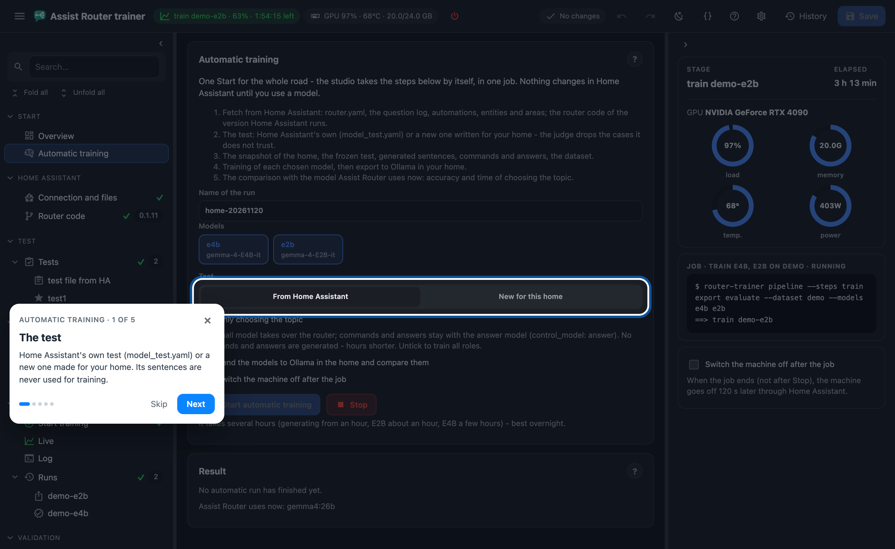

# The screen {#screen}

The studio looks and works like the Home Dashboard and Assist Router editors and the other GPU studios.

## The top bar {#top-bar}

From the left: the ☰ menu (the guide, who is logged in, Log out), the name; the running
job (stage, progress) and the machine (GPU load, temperature, memory, power) with Switch the
machine off; the countdown "switching off in 1:45 · Cancel" and its errors; a red pill when the router code
differs from Home Assistant's; the draft state, undo / redo, Discard draft; the look,
YAML, **?** (this guide in a new tab), ⚙ (a small window with the theme and the language, [described here](guide.md#guide-screen)), History,
Save.

## The tree {#tree}

The steps in working order - Start, Home Assistant, Test, Dataset, Training, Validation - then the settings. A ✓
marks a done step, a number counts tests, datasets and runs, ⚠ shows a problem (a token rejected, router code
of another version, a dataset built with other prompts). Search and folding stay in the browser.

## The columns {#columns}

- **middle** - the view of the chosen item; every card has one **?**: a small popup with what that card does and a
  quiet link to its part of this guide (✕, Esc or a click beside it closes it). Only the **?** in the top bar opens
  this guide;
- **right** - live: stage, time, the card's rings, the job's last lines and
  Switch the machine off after the job; in the settings - the YAML of the chosen part.

‹ at the top of the left column and › at the top of the right one fold them to a narrow bar (Ctrl/⌘+B the left,
Ctrl/⌘+Alt+B the right); the browser remembers it, and an unfolded column gets its width back. In a window narrower
than 900 px the right column starts folded.

## Settings, the draft and the history {#draft}

The settings are `trainer.yaml` as forms. Every change goes to a **draft kept on the machine** (it survives closing
the browser and a restart) - nothing changes until Save. A changed field replaces only its
value in the text, so the file's comments and their alignment stay: one field = one line in the diff. Saving shows
the changed parts and lines and takes a note; when the file changed elsewhere, Save anyway.
The History keeps 30 versions; restoring makes a version the draft. Shortcuts: Ctrl/⌘+S,
Ctrl/⌘+Z, Ctrl/⌘+Shift+Z.

## The tour and the lessons {#tour}

The first time the studio opens in a browser, the **tour** goes through the parts of the screen: one part framed,
the rest dimmed, a bubble saying what it is and where it is set (the tree, the middle, the right column, the
machine and the job, the draft, YAML, help). Esc or Skip ends it; ⚙ →
Tour of the studio shows it again.

⚙ → Lessons lists every task of the trainer as a short lesson that **goes where the task is
done** and frames one thing at a time. A step that waits for the framed button moves on when you click it, so the
task is done while you learn it (Next works too). Done lessons get a ✓ in this browser; a
lesson that needs something the workspace has not got yet (a test, a dataset, a trained model) says what. The ? of a
card offers the lesson of its place: Show me step by step.

| Group | Lessons |
|---|---|
| The start | Connect Home Assistant · Fetch from Home Assistant · Automatic training · Read the result and use it · Watch the training |
| Further steps | Choose and review the test · Generate the data · The dataset · Train one model · Resume a stopped run · Export and compare · Try a sentence · The job history |
| Set up once | Choose the teacher · The teacher by hand · Change and save settings · The whole file · The machine's power · Look and language |
