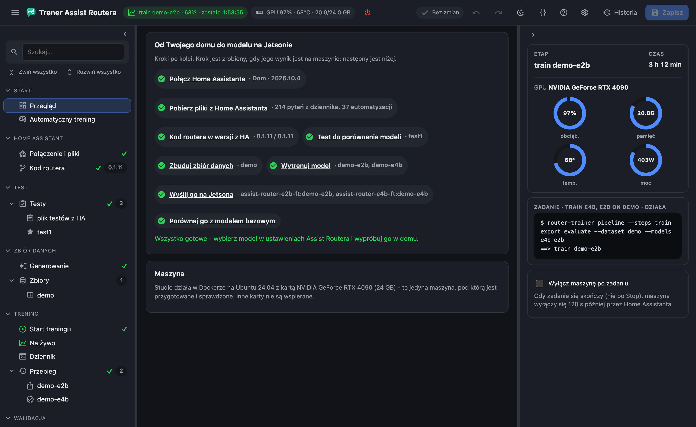
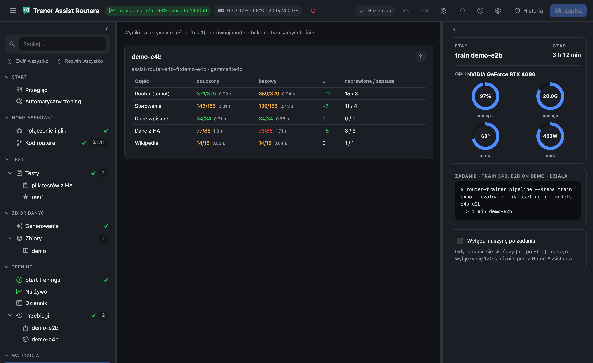
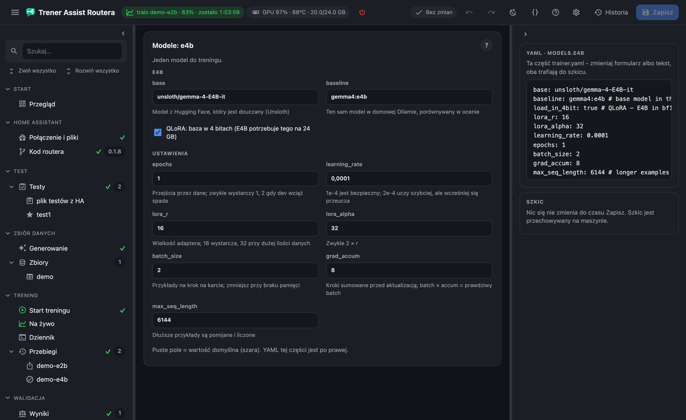
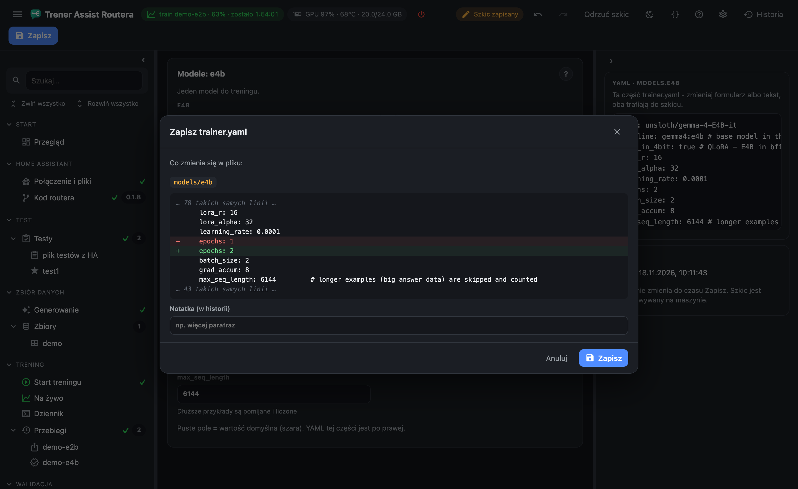

# Ekran {#screen}

Studio wygląda i działa jak edytory Home Dashboard i Assist Routera oraz pozostałe studia GPU.

## Górny pasek {#top-bar}

Od lewej: menu ☰ (przewodnik, kto jest zalogowany, Wyloguj), nazwa; trwające zadanie
(etap, postęp) i maszyna (obciążenie GPU, temperatura, pamięć, moc) z Wyłącz maszynę;
odliczanie „Wyłączenie za 1:45 · Anuluj” i jego błędy; czerwona pigułka, gdy kod routera różni się od wersji w Home
Assistancie; stan szkicu, cofnij / ponów, Odrzuć szkic; wygląd, YAML,
**?** (ten przewodnik w nowej karcie), ⚙ (małe okienko z motywem i językiem, [opis tutaj](guide.md#guide-screen)), Historia,
Zapisz.

## Drzewo {#tree}

Kroki w kolejności pracy - Start, Home Assistant, Test, Zbiór danych, Trening, Walidacja - potem ustawienia. ✓
oznacza zrobiony krok, liczba podaje testy, zbiory i przebiegi, ⚠ pokazuje problem (odrzucony token, kod routera w
innej wersji, zbiór zbudowany na innych promptach). Wyszukiwanie i zwinięcie zostają w przeglądarce.

## Kolumny {#columns}

- **środek** - widok wybranego elementu; każda karta ma jeden **?**: małe okienko z opisem tej karty i dyskretnym
  linkiem do jej części przewodnika (zamyka je ✕, Esc albo kliknięcie obok). Tylko **?** w górnym pasku otwiera ten
  przewodnik;
- **prawa** - na żywo: etap, czas, pierścienie karty, ostatnie linie zadania i
  Wyłącz maszynę po zadaniu; w ustawieniach - YAML wybranej części.

‹ na górze lewej kolumny i › na górze prawej zwijają je do wąskiego paska (Ctrl/⌘+B lewą, Ctrl/⌘+Alt+B prawą);
przeglądarka to pamięta, a rozwinięta kolumna wraca do swojej szerokości. W oknie węższym niż 900 px prawa kolumna
jest na start zwinięta.

## Ustawienia, szkic i historia {#draft}

Ustawienia to `trainer.yaml` w formularzach. Każda zmiana trafia do **szkicu trzymanego na maszynie** (przetrwa
zamknięcie przeglądarki i restart) - nic się nie zmienia do Zapisz. Zmienione pole podmienia
tylko swoją wartość w tekście, więc komentarze pliku i ich wyrównanie zostają: jedno pole = jedna linia w różnicach.
Zapis pokazuje zmienione części i linie oraz przyjmuje notatkę; gdy plik zmienił się gdzie indziej,
Zapisz mimo to. Historia trzyma 30 wersji; przywrócenie robi z wersji
szkic. Skróty: Ctrl/⌘+S, Ctrl/⌘+Z, Ctrl/⌘+Shift+Z.

