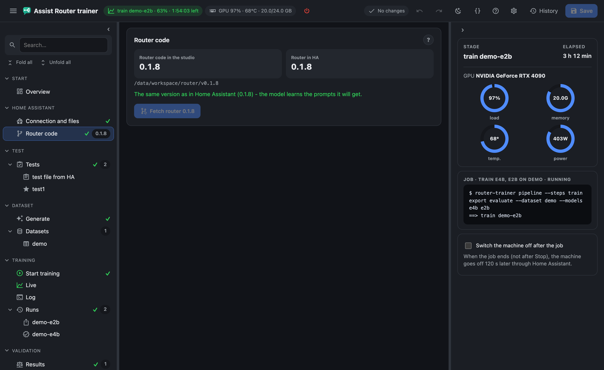
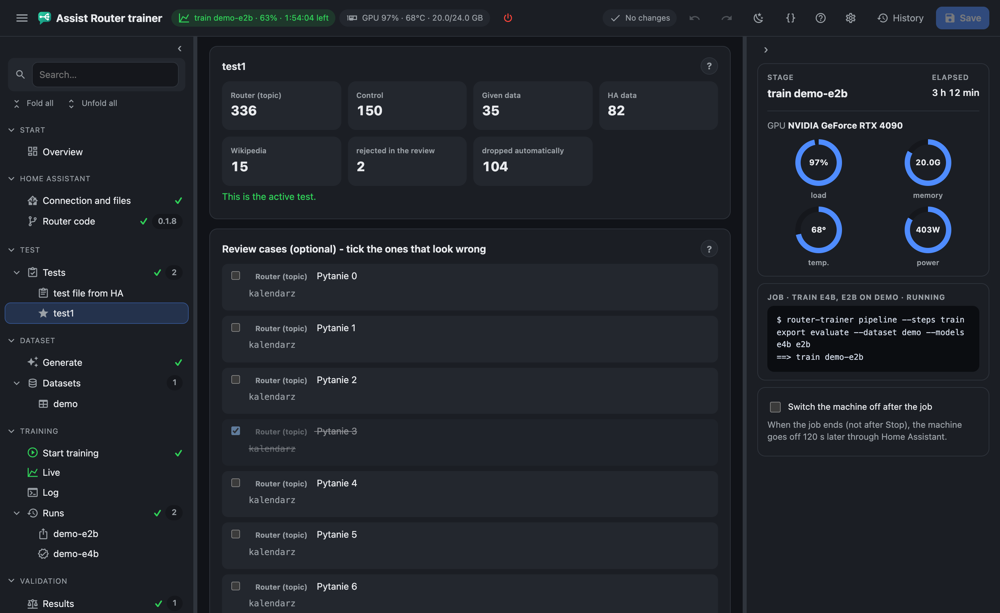
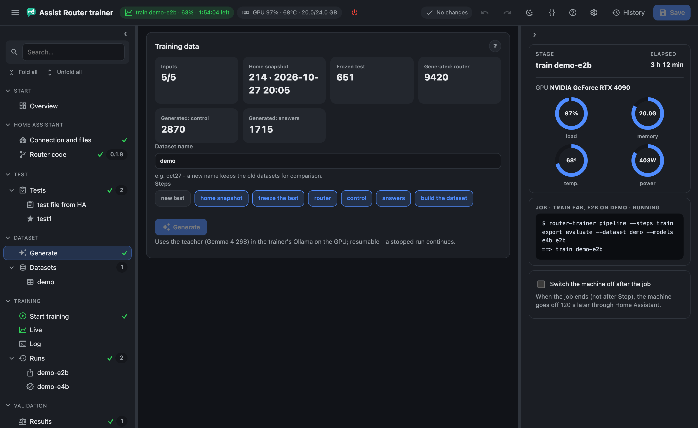

# Step by step {#steps}

The whole road, in the order of the tree. The overview shows what is done and the **next step**.

## 1. Home Assistant {#home-assistant}

**Home Assistant → Connection and files**: the HA address (with the port) and an **administrator's** long-lived
token (HA profile → Security), then Connect to HA. The token is kept on the machine
(mode 600) and never shown again. Then Fetch from Home Assistant: router.yaml, the log of
unrecognized commands, the test files, every automation with a conversation trigger (also from `packages/`) and
`custom_sentences`, through Assist Router's read-only export command (0.1.8+). Fetch before every new dataset.

## 2. Router code {#router-code}

**Home Assistant → Router code** compares the studio's router code with HA's version; when they differ,
Fetch router {version} clones that tag from GitHub (no image rebuild). The model must learn
the prompts it will get.

## 3. Test {#test}

**Test → Tests**: the active test is the only measure. The test from HA (`/config/assist/model_test.yaml`) or a
generated one - Create test: a writer model (Bielik 11B) writes cases from your home and
log, the teacher (Gemma 26B) checks them; only what both understand the same way stays.

| Part | Cases from | Expectation from |
|---|---|---|
| Router | real log questions, the writer adds missing topics | both models name the same topic |
| Control | commands planned from your home | the plan; kept when the judge parses it the same |
| Given data | made-up data (pocket money, calendars, lessons) | facts computed in Python |
| HA data | questions on topics with data | facts **literally** in your HA data |
| Wikipedia | titles outside the training pool | facts literally in the article |

The review is optional: tick odd cases - they do not count. After changing the active test or the review, freeze
the test and build the dataset again.

## 4. Dataset {#dataset}

**Dataset → Generate** runs the steps (each can be ticked on its own): new test (optional), home snapshot,
freezing the test, router, control, answers, building the dataset; then Generate.
Generating can be stopped and continues where it ended; it takes from tens of minutes to a few hours.

| Step | What it does |
|---|---|
| home snapshot | entities, aliases, areas, scripts, scenes from HA; the prompts' fingerprint |
| freezing the test | collects the test's sentences - nothing like them goes into training |
| router | sentences of your automations' triggers, built-in HA intents with your names, paraphrases, knowledge questions, gibberish, real log questions |
| control | Python plans a command from your home, the teacher writes and parses it back; kept only when it matches |
| answers | made-up data with Python facts, your live HA data, Wikipedia summaries |
| building | chats with the integration's functions, drop test-like sentences, even topics, noise, train/dev split |

## 5. Training {#training}

**Training → Start training**: the dataset, the models and optionally parameters for this run (empty = the
settings), "then export and test", and Switch the machine off after the job;
Start. Resume continues from the last checkpoint and says how much
it will really train. Stop saves a checkpoint.

## 6. Export {#export}

**Training → Runs → Export**: GGUF (q8_0), a check in the studio's Ollama, then the
upload to Ollama on the Jetson as `assist-router-<model>-ft:<run>` (after checking that it fits next to the loaded
models). Assist Router uses it only after you choose it in the integration's options; the old model stays.

## 7. Validation {#validation}

**Validation → Results**: the active test for the trained and the base model in Ollama on the Jetson, five parts,
fixed and broken cases. **Try it** sends one sentence to the chosen models (nothing runs in the home). How to read
the results: [Doing it well](good-practice.md#results).

