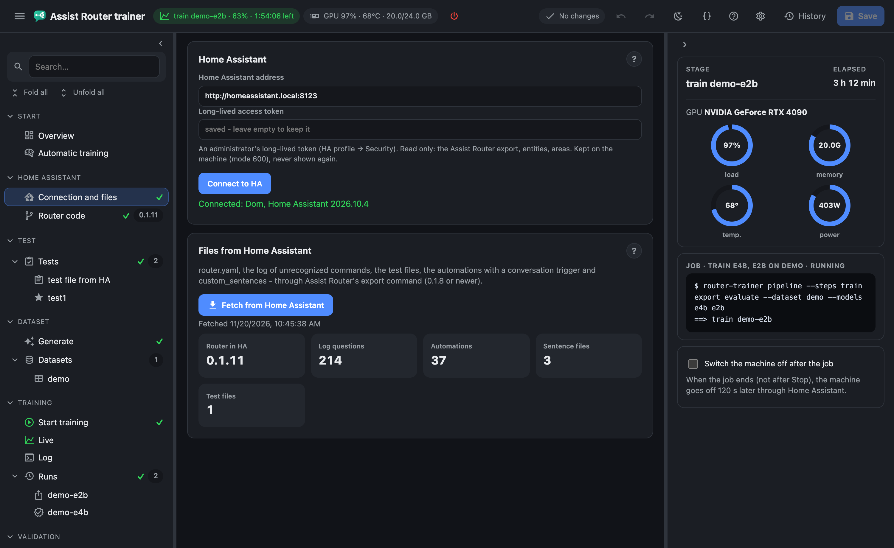
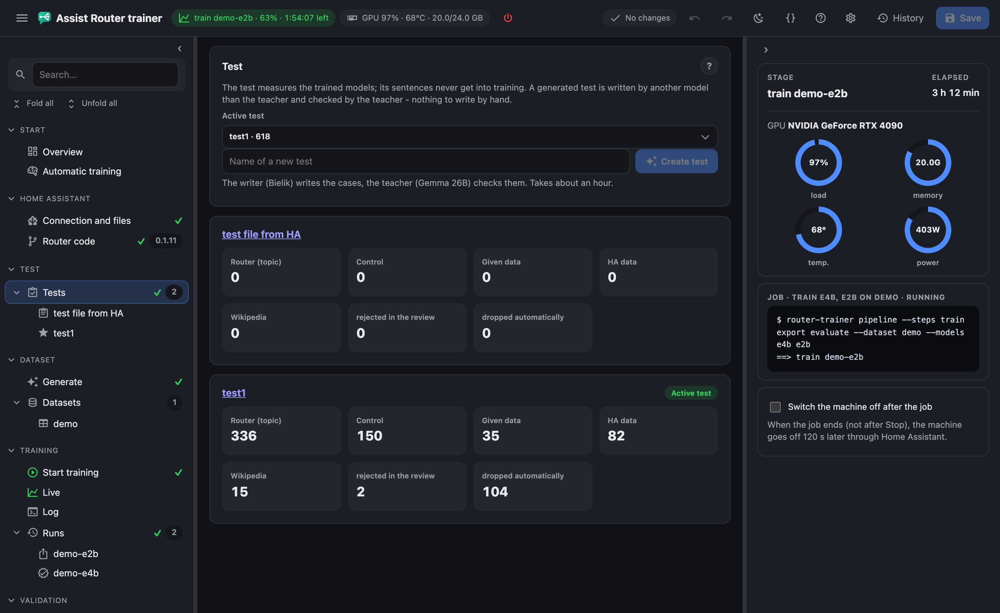
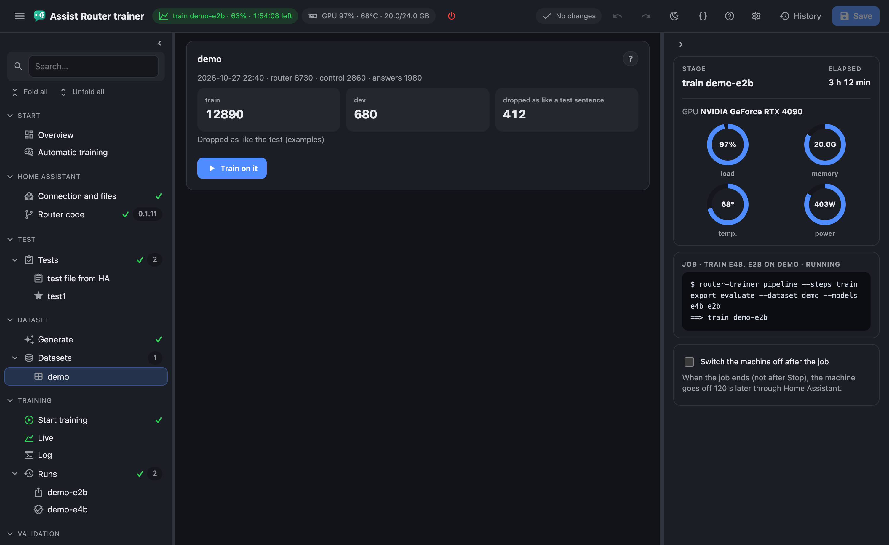
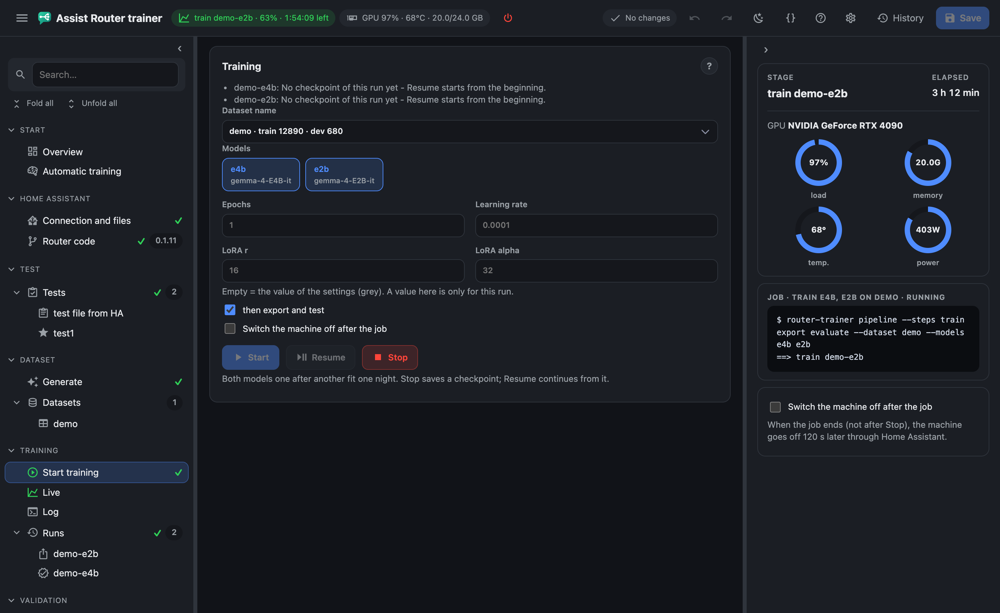
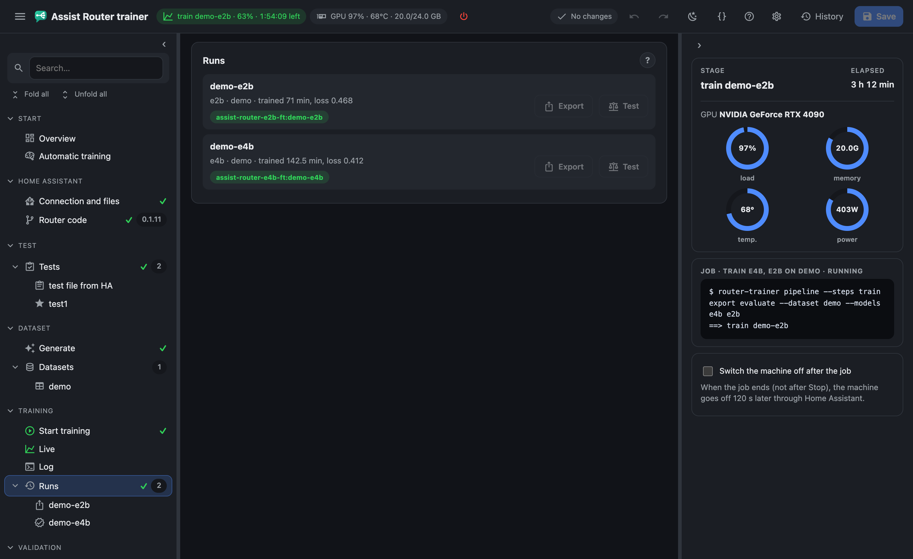
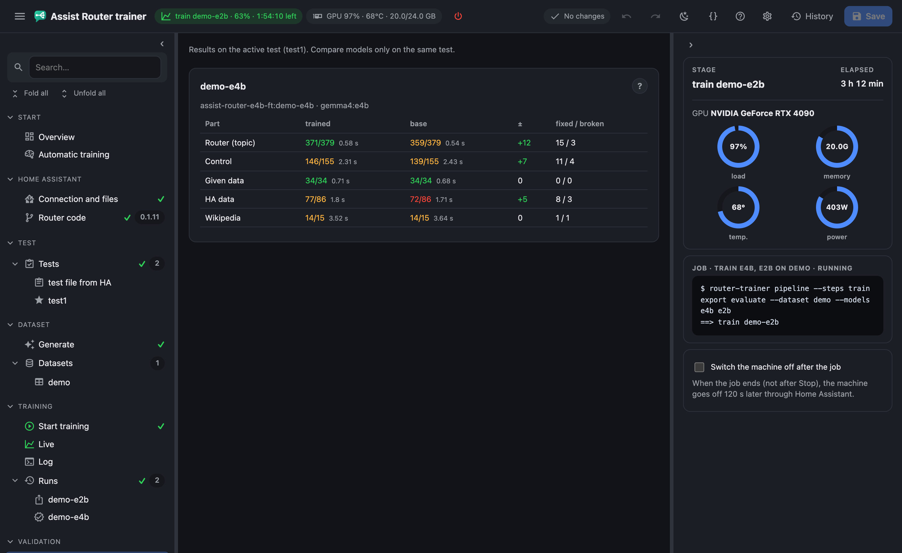

# Step by step {#steps}

The whole road, in the order of the tree. The overview shows what is done and the **next step**.

## Automatic training {#auto}

**Start → Automatic training** takes all the steps of this page by itself, as one job - best overnight:

1. fetching from Home Assistant (like step 1) and the router code of the version Home Assistant runs (step 2);
2. the test: From Home Assistant (`model_test.yaml`, if you have one) or
   New for this home - the writer and the judge as in step 3; cases the judge does not
   trust drop out by themselves, so nothing waits for a review;
3. the home snapshot, freezing the test, generating and the dataset (step 4);
4. training of each ticked model (step 5), export to Ollama in the home (step 6);
5. the comparison with the model Assist Router uses now (the model's `baseline` in the settings, e.g.
   `gemma4:26b`).

At the end the **Result** card shows for each model the accuracy of choosing the topic and the average time - new
and now - and a verdict: *better* (at least as accurate and faster), *as accurate, not faster* or *less accurate*.
The most accurate of the better ones is recommended. Nothing changes in Home Assistant until you click
Use in Assist Router and confirm: the studio then sets the **router model** in Assist
Router's options (Configure → Question router), as when it is changed by hand; the answer model stays. The model
before is remembered - *Restore* puts it back.

Only choosing the topic (the default): the small model takes over the router alone,
control commands and answers stay with the answer model - then they are not generated, which makes the run hours
shorter. Untick it if the model is to do everything.

**Real speech in the data.** The router's questions get two sources through Home Assistant's Piper and Whisper
(Wyoming, ports 10200 and 10300 of the home server):

- natural questions read by Piper (every voice of the language in turn) and written by Whisper - the ones Whisper
  wrote differently stay, with the topic of the original (`asr_per_topic`, 40 per topic by default);
- recordings of your own commands, if Home Assistant keeps them (`assist_pipeline: debug_recording_dir`), copied
  to `inputs/recordings` in the workspace - Whisper writes them, the teacher gives the topic, test-like sentences
  drop out. The recordings and their text stay on the machine.

Without the home server both sources are skipped with a message.

**Labels that agree with `router.yaml`.** The teacher writes paraphrases seeing one topic at a time, so now and
then it writes a sentence `router.yaml` sends elsewhere („Puść podcast w kuchni” for `media`, although its
description says that „puść” is `sterowanie`). The small model then learns exactly that mistake. So every teacher
sentence is read once more **with the router's own prompt** (all topics and descriptions, as Home Assistant asks):
a sentence that lands in another topic is dropped with its Whisper copies, and the paraphrases refill what is
missing (`check_labels`, on by default). The answers are in `generated/labels.json`, the dropped sentences in
`generated/labels_dropped.jsonl` - worth a look, they show unclear topic descriptions.

**Contrast pairs.** For topics that get mixed up the teacher writes sentences on both sides of the border: the same
words, rooms and devices, a different topic („Co teraz gra w kuchni?” - `media`, „Puść muzykę w kuchni” -
`sterowanie`). Each has to pass the label check. The pairs come from the errors of the last evaluations
(`contrast.pairs: auto`, of the trained models and of the baseline) or from a list in the settings;
`contrast.per_side` sentences per topic of a pair (40 by default). `contrast.extra` pairs are always added,
also with `auto` - for a new topic that has no evaluation errors yet (`[[czytania, wiadomosci]]`).

**Automation triggers** get their topic by key in `topic_overrides`. A key is the whole automation `id` or one of
its triggers: `id#number` (from 0, in the order of its `conversation` triggers) - for example questions about the
alarm state in `alarm` and the commands „włącz alarm” in `sterowanie`.

The topic is what is judged, because only that is taken over by the small model. Parsing control commands goes
through the answer model when `router.yaml` has `control_model: answer`.

## 1. Home Assistant {#home-assistant}

**Home Assistant → Connection and files**: the HA address (with the port) and an **administrator's** long-lived
token (HA profile → Security), then Connect to HA. The token is kept on the machine
(mode 600) and never shown again. Then Fetch from Home Assistant: router.yaml, the log of
unrecognized commands, the test files, every automation with a conversation trigger (also from `packages/`) and
`custom_sentences`, through Assist Router's read-only export command (0.1.8+). Fetch before every new dataset.

## 2. Router code {#router-code}

**Home Assistant → Router code** compares the studio's router code with HA's version; when they differ,
Fetch router {version} clones that tag from GitHub (no image rebuild). The model must learn
the prompts it will get.

## 3. Test {#test}

**Test → Tests**: the active test is the only measure. The test from HA (`/config/assist/model_test.yaml`) or a
generated one - Create test: a writer model (Bielik 11B) writes cases from your home and
log, the teacher (Gemma 26B) checks them; only what both understand the same way stays.

| Part | Cases from | Expectation from |
|---|---|---|
| Router | real log questions, the writer adds missing topics | both models name the same topic |
| Control | commands planned from your home | the plan; kept when the judge parses it the same |
| Given data | made-up data (pocket money, calendars, lessons) | facts computed in Python |
| HA data | questions on topics with data | facts **literally** in your HA data |
| Wikipedia | titles outside the training pool | facts literally in the article |

The review is optional: tick odd cases - they do not count. After changing the active test or the review, freeze
the test and build the dataset again.

## 4. Dataset {#dataset}

**Dataset → Generate** runs the steps (each can be ticked on its own): new test (optional), home snapshot,
freezing the test, router, control, answers, building the dataset; then Generate.
Generating can be stopped and continues where it ended; it takes from tens of minutes to a few hours.

| Step | What it does |
|---|---|
| home snapshot | entities, aliases, areas, scripts, scenes from HA; the prompts' fingerprint |
| freezing the test | collects the test's sentences - nothing like them goes into training |
| router | sentences of your automations' triggers, built-in HA intents with your names, paraphrases, knowledge questions, gibberish, real log questions |
| control | Python plans a command from your home, the teacher writes and parses it back; kept only when it matches |
| answers | made-up data with Python facts, your live HA data, Wikipedia summaries |
| building | chats with the integration's functions, drop test-like sentences, even topics, noise, train/dev split |

## 5. Training {#training}

**Training → Start training**: the dataset, the models and optionally parameters for this run (empty = the
settings), "then export and test", and Switch the machine off after the job;
Start. Resume continues from the last checkpoint and says how much
it will really train. Stop saves a checkpoint.

## 6. Export {#export}

**Training → Runs → Export**: GGUF (q8_0), a check in the studio's Ollama, then the
upload to Ollama on the Jetson as `assist-router-<model>-ft:<run>` (after checking that it fits next to the loaded
models). Assist Router uses it only after you choose it in the integration's options; the old model stays.

## 7. Validation {#validation}

**Validation → Results**: the active test for the trained and the base model in Ollama on the Jetson, five parts,
fixed and broken cases. **Try it** sends one sentence to the chosen models (nothing runs in the home). How to read
the results: [Doing it well](good-practice.md#results).

