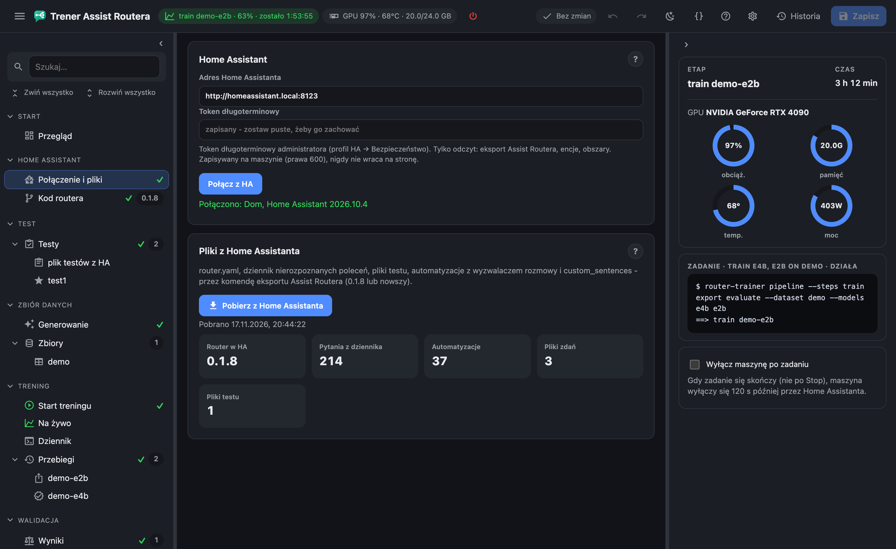
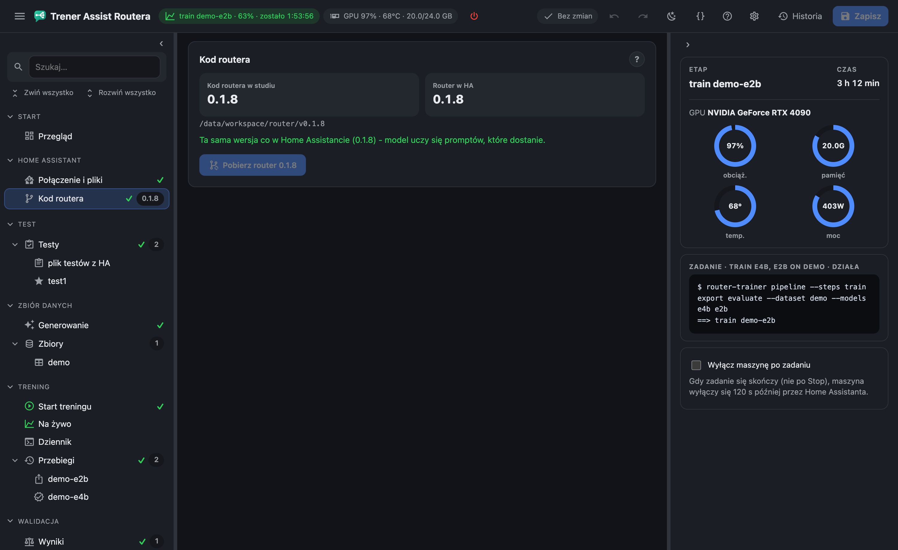
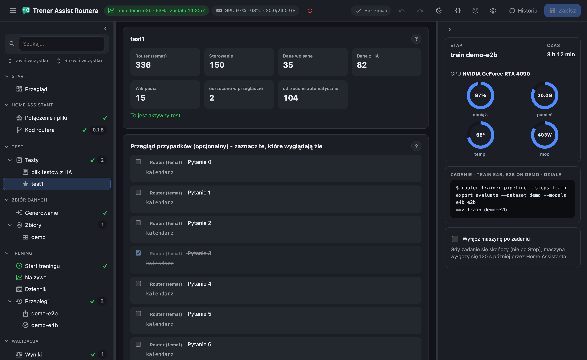
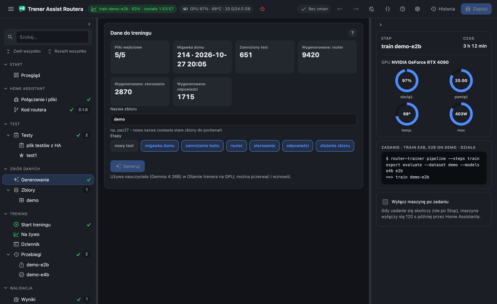
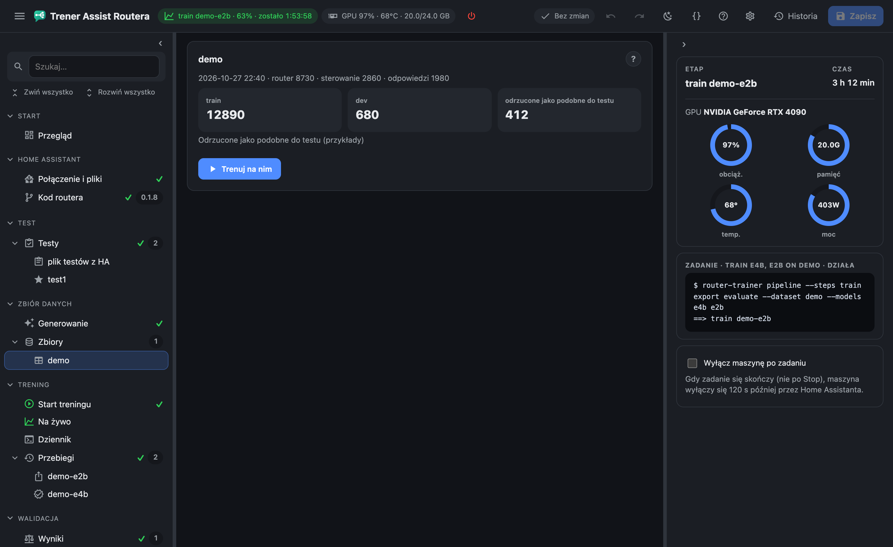
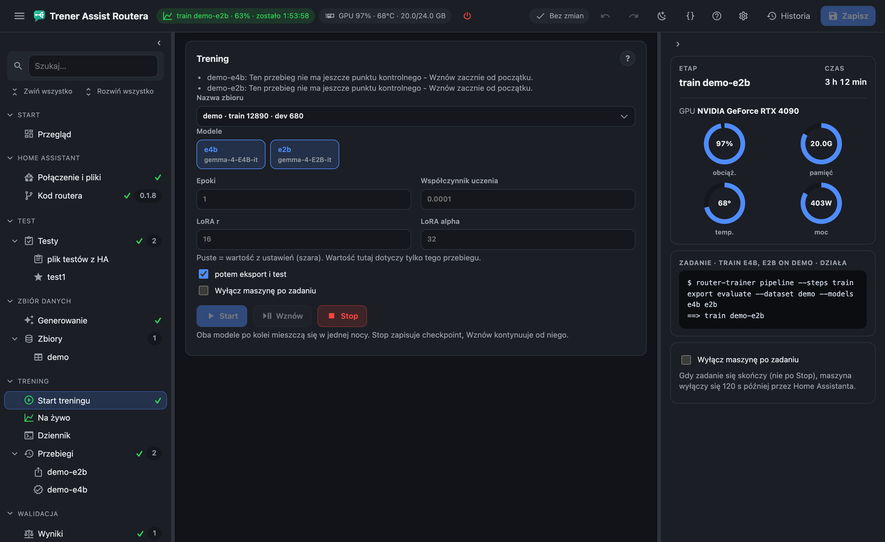
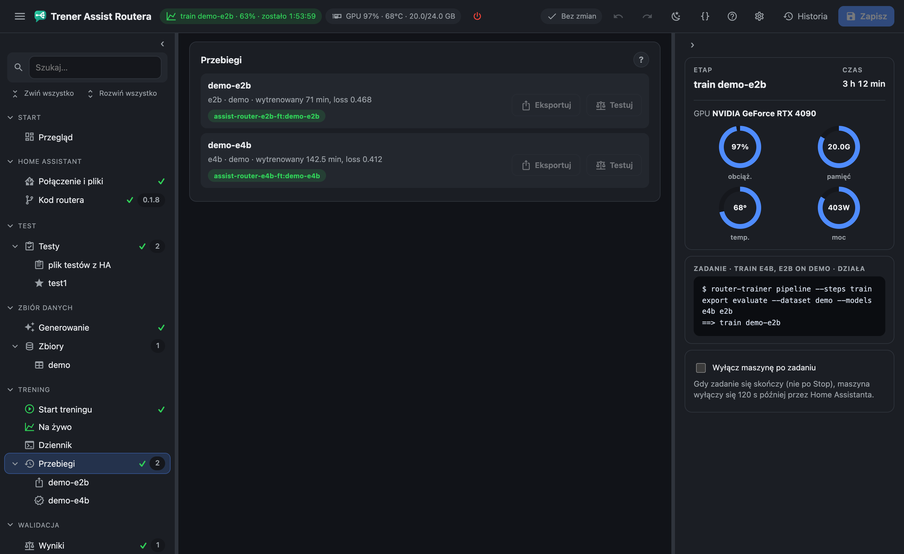
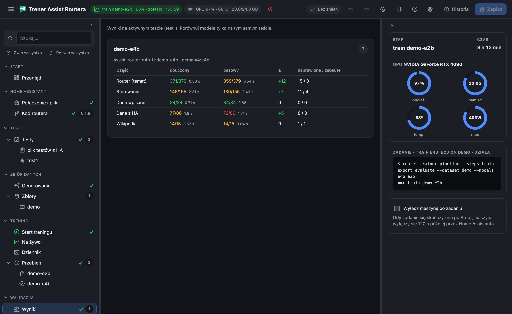

# Krok po kroku {#steps}

Cała droga w kolejności drzewa. Przegląd pokazuje, co jest zrobione, i **następny krok**.

## 1. Home Assistant {#home-assistant}

**Home Assistant → Połączenie i pliki**: adres HA (z portem) i długoterminowy token **administratora** (profil HA →
Bezpieczeństwo), potem Połącz z HA. Token jest trzymany na maszynie (prawa 600) i nigdy
więcej nie jest pokazywany. Potem Pobierz z Home Assistanta: router.yaml, dziennik
nierozpoznanych poleceń, pliki testu, każda automatyzacja z wyzwalaczem rozmowy (także z `packages/`) i
`custom_sentences` - przez komendę eksportu Assist Routera (0.1.8+, tylko odczyt). Pobieraj przed każdym nowym
zbiorem.

## 2. Kod routera {#router-code}

**Home Assistant → Kod routera** porównuje kod routera w studiu z wersją w HA; gdy się różnią,
Pobierz router {version} klonuje ten tag z GitHuba (bez przebudowy obrazu). Model musi się
uczyć promptów, które potem dostanie.

## 3. Test {#test}

**Test → Testy**: aktywny test to jedyna miara. Test z HA (`/config/assist/model_test.yaml`) albo generowany -
Utwórz test: model-pisarz (Bielik 11B) pisze przypadki z Twojego domu i dziennika,
nauczyciel (Gemma 26B) je sprawdza; zostaje tylko to, co oba rozumieją tak samo.

| Część | Przypadki z | Oczekiwanie z |
|---|---|---|
| Router | prawdziwe pytania z dziennika, pisarz dopisuje brakujące tematy | oba modele wskazują ten sam temat |
| Sterowanie | polecenia zaplanowane z Twojego domu | plan; zostaje, gdy sędzia rozbiera je tak samo |
| Dane podane | wymyślone dane (kieszonkowe, kalendarze, lekcje) | fakty policzone w Pythonie |
| Dane z HA | pytania o tematy z danymi | fakty **dosłownie** w Twoich danych z HA |
| Wikipedia | hasła spoza puli treningowej | fakty dosłownie w artykule |

Przegląd jest opcjonalny: zaznacz dziwne przypadki - nie będą liczone. Po zmianie aktywnego testu albo przeglądu
zamroź test i zbuduj zbiór od nowa.

## 4. Zbiór danych {#dataset}

**Zbiór danych → Generowanie** uruchamia kroki (każdy można zaznaczyć osobno): nowy test (opcjonalnie), migawka
domu, zamrożenie testu, router, sterowanie, odpowiedzi, złożenie zbioru; potem Start.
Generowanie można zatrzymać i zaczyna od miejsca przerwania; trwa od kilkudziesięciu minut do kilku godzin.

| Krok | Co robi |
|---|---|
| migawka domu | encje, aliasy, obszary, skrypty, sceny z HA; odcisk promptów |
| zamrożenie testu | zbiera zdania testu - nic do nich podobnego nie trafi do treningu |
| router | zdania wyzwalaczy Twoich automatyzacji, wbudowane intencje HA z Twoimi nazwami, parafrazy, pytania o wiedzę, bełkot, prawdziwe pytania z dziennika |
| sterowanie | Python planuje polecenie z Twojego domu, nauczyciel je pisze i rozbiera z powrotem; zostaje tylko zgodne |
| odpowiedzi | wymyślone dane z faktami z Pythona, Twoje dane z HA na żywo, streszczenia z Wikipedii |
| złożenie | rozmowy z funkcjami integracji, odrzucenie zdań podobnych do testu, wyrównanie tematów, szum, podział train/dev |

## 5. Trening {#training}

**Trening → Start treningu**: zbiór, modele i opcjonalnie parametry tego przebiegu (puste = ustawienia), „potem
eksport i test” oraz Wyłącz maszynę po zadaniu; Start.
Wznów kontynuuje od ostatniego punktu kontrolnego i mówi, ile naprawdę zostało do
wytrenowania. Stop zapisuje punkt kontrolny.

## 6. Eksport {#export}

**Trening → Przebiegi → Eksport**: GGUF (q8_0), sprawdzenie w Ollamie studia, potem wysłanie
do Ollamy na Jetsonie jako `assist-router-<model>-ft:<przebieg>` (po sprawdzeniu, czy zmieści się obok
załadowanych modeli). Assist Router użyje go dopiero, gdy wybierzesz go w opcjach integracji; stary model zostaje.

## 7. Walidacja {#validation}

**Walidacja → Wyniki**: aktywny test dla douczonego i bazowego modelu w Ollamie na Jetsonie, pięć części,
przypadki naprawione i zepsute. **Wypróbuj** wysyła jedno zdanie do wybranych modeli (nic nie wykonuje się w domu).
Jak czytać wyniki: [Jak robić to dobrze](good-practice.md#results).

