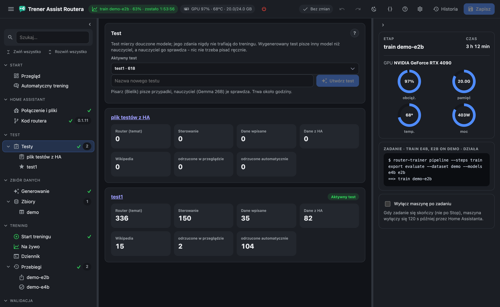

# Krok po kroku {#steps}

Cała droga w kolejności drzewa. Przegląd pokazuje, co jest zrobione, i **następny krok**.

## Automatyczny trening {#auto}

**Start → Automatyczny trening** przechodzi wszystkie kroki z tej strony sam, jednym zadaniem - najlepiej na noc:

1. pobranie z Home Assistanta (jak krok 1) i kod routera w wersji z Home Assistanta (krok 2);
2. test: Z Home Assistanta (`model_test.yaml`, jeśli go masz) albo
   Nowy dla tego domu - pisarz i sędzia jak w kroku 3; przypadki, którym sędzia nie
   ufa, odpadają same, więc nic nie czeka na przegląd;
3. migawka domu, zamrożenie testu, generowanie i zbiór (krok 4);
4. trening każdego zaznaczonego modelu (krok 5), eksport do Ollamy w domu (krok 6);
5. porównanie z modelem, którego Assist Router używa teraz (`baseline` modelu w ustawieniach, np. `gemma4:26b`).

Na końcu karta **Wynik** pokazuje dla każdego modelu trafność wyboru tematu i średni czas - nowy i obecny - oraz
ocenę: *lepszy* (co najmniej tak samo trafny i szybszy), *tak samo trafny, nie szybszy* albo *mniej trafny*.
Polecany jest najtrafniejszy z lepszych. Nic w Home Assistancie się nie zmienia, dopóki nie klikniesz
Użyj w Assist Routerze i nie potwierdzisz: studio ustawia wtedy **model routera** w opcjach
Assist Routera (Konfiguruj → Router pytań), jak przy ręcznej zmianie; model odpowiedzi zostaje. Poprzedni model
jest zapamiętany - przycisk *Przywróć* stawia go z powrotem.

Tylko wybór tematu (domyślnie): mały model przejmuje sam router, a polecenia sterowania
i odpowiedzi zostają przy modelu odpowiedzi - wtedy nie są generowane, co skraca bieg o kilka godzin. Odznacz,
jeśli model ma robić wszystko.

**Prawdziwa mowa w danych.** Do pytań routera dochodzą dwa źródła przez Pipera i Whispera z Home Assistanta
(Wyoming, porty 10200 i 10300 serwera domu):

- naturalne pytania przeczytane przez Pipera (wszystkie polskie głosy po kolei) i zapisane przez Whispera -
  zostają te, które Whisper zapisał inaczej, z tematem oryginału (`asr_per_topic`, domyślnie 40 na temat);
- nagrania Waszych poleceń, jeśli Home Assistant je zbiera (`assist_pipeline: debug_recording_dir`), skopiowane
  do `inputs/recordings` w obszarze roboczym - Whisper je zapisuje, nauczyciel daje temat, zdania podobne do
  testu odpadają. Nagrania i ich tekst zostają na maszynie.

Bez serwera domu oba źródła są pomijane z komunikatem.

**Etykiety zgodne z `router.yaml`.** Nauczyciel pisze parafrazy, widząc jeden temat naraz, więc czasem napisze
zdanie, które `router.yaml` kieruje gdzie indziej (np. „Puść podcast w kuchni” dla `media`, choć opis mówi, że
„puść” to `sterowanie`). Mały model uczy się wtedy dokładnie tego błędu. Dlatego każde zdanie nauczyciela jest
czytane jeszcze raz **z pełnym promptem routera** (wszystkie tematy i opisy, jak pyta Home Assistant) - zdanie,
które trafia do innego tematu, odpada razem ze swoimi kopiami z Whispera, a parafrazy dopełniają brakujące
(`check_labels`, domyślnie włączone). Odpowiedzi są w `generated/labels.json`, odrzucone zdania w
`generated/labels_dropped.jsonl` - warto je przejrzeć, bo pokazują niejasne opisy tematów.

**Pary kontrastowe.** Dla tematów, które się mylą, nauczyciel pisze zdania z obu stron granicy: te same słowa,
pokoje i urządzenia, ale różny temat („Co teraz gra w kuchni?” - `media`, „Puść muzykę w kuchni” - `sterowanie`).
Każde musi przejść sprawdzenie etykiety. Pary biorą się z błędów ostatnich walidacji (`contrast.pairs: auto`,
zarówno uczonych modeli, jak i bazowego) albo z listy w ustawieniach; `contrast.per_side` zdań na temat pary
(domyślnie 40). Pary z `contrast.extra` dochodzą zawsze, także przy `auto` - dla nowego tematu, który
nie ma jeszcze błędów w walidacjach (`[[czytania, wiadomosci]]`).

**Wyzwalacze automatyzacji** dostają temat po swoim kluczu w `topic_overrides`. Kluczem może być całe
`id` automatyzacji albo jeden jej wyzwalacz: `id#numer` (od 0, w kolejności wyzwalaczy `conversation`), np.
pytania o stan alarmu w `alarm`, a polecenia „włącz alarm” w `sterowanie`.

Oceniany jest wybór tematu, bo tylko to przejmuje mały model. Rozbiór poleceń sterowania idzie przez model
odpowiedzi, gdy w `router.yaml` jest `control_model: answer`.

## 1. Home Assistant {#home-assistant}

**Home Assistant → Połączenie i pliki**: adres HA (z portem) i długoterminowy token **administratora** (profil HA →
Bezpieczeństwo), potem Połącz z HA. Token jest trzymany na maszynie (prawa 600) i nigdy
więcej nie jest pokazywany. Potem Pobierz z Home Assistanta: router.yaml, dziennik
nierozpoznanych poleceń, pliki testu, każda automatyzacja z wyzwalaczem rozmowy (także z `packages/`) i
`custom_sentences` - przez komendę eksportu Assist Routera (0.1.8+, tylko odczyt). Pobieraj przed każdym nowym
zbiorem.

## 2. Kod routera {#router-code}

**Home Assistant → Kod routera** porównuje kod routera w studiu z wersją w HA; gdy się różnią,
Pobierz router {version} klonuje ten tag z GitHuba (bez przebudowy obrazu). Model musi się
uczyć promptów, które potem dostanie.

## 3. Test {#test}

**Test → Testy**: aktywny test to jedyna miara. Test z HA (`/config/assist/model_test.yaml`) albo generowany -
Utwórz test: model-pisarz (Bielik 11B) pisze przypadki z Twojego domu i dziennika,
nauczyciel (Gemma 26B) je sprawdza; zostaje tylko to, co oba rozumieją tak samo.

| Część | Przypadki z | Oczekiwanie z |
|---|---|---|
| Router | prawdziwe pytania z dziennika, pisarz dopisuje brakujące tematy | oba modele wskazują ten sam temat |
| Sterowanie | polecenia zaplanowane z Twojego domu | plan; zostaje, gdy sędzia rozbiera je tak samo |
| Dane podane | wymyślone dane (kieszonkowe, kalendarze, lekcje) | fakty policzone w Pythonie |
| Dane z HA | pytania o tematy z danymi | fakty **dosłownie** w Twoich danych z HA |
| Wikipedia | hasła spoza puli treningowej | fakty dosłownie w artykule |

Przegląd jest opcjonalny: zaznacz dziwne przypadki - nie będą liczone. Po zmianie aktywnego testu albo przeglądu
zamroź test i zbuduj zbiór od nowa.

## 4. Zbiór danych {#dataset}

**Zbiór danych → Generowanie** uruchamia kroki (każdy można zaznaczyć osobno): nowy test (opcjonalnie), migawka
domu, zamrożenie testu, router, sterowanie, odpowiedzi, złożenie zbioru; potem Start.
Generowanie można zatrzymać i zaczyna od miejsca przerwania; trwa od kilkudziesięciu minut do kilku godzin.

| Krok | Co robi |
|---|---|
| migawka domu | encje, aliasy, obszary, skrypty, sceny z HA; odcisk promptów |
| zamrożenie testu | zbiera zdania testu - nic do nich podobnego nie trafi do treningu |
| router | zdania wyzwalaczy Twoich automatyzacji, wbudowane intencje HA z Twoimi nazwami, parafrazy, pytania o wiedzę, bełkot, prawdziwe pytania z dziennika |
| sterowanie | Python planuje polecenie z Twojego domu, nauczyciel je pisze i rozbiera z powrotem; zostaje tylko zgodne |
| odpowiedzi | wymyślone dane z faktami z Pythona, Twoje dane z HA na żywo, streszczenia z Wikipedii |
| złożenie | rozmowy z funkcjami integracji, odrzucenie zdań podobnych do testu, wyrównanie tematów, szum, podział train/dev |

## 5. Trening {#training}

**Trening → Start treningu**: zbiór, modele i opcjonalnie parametry tego przebiegu (puste = ustawienia), „potem
eksport i test” oraz Wyłącz maszynę po zadaniu; Start.
Wznów kontynuuje od ostatniego punktu kontrolnego i mówi, ile naprawdę zostało do
wytrenowania. Stop zapisuje punkt kontrolny.

## 6. Eksport {#export}

**Trening → Przebiegi → Eksport**: GGUF (q8_0), sprawdzenie w Ollamie studia, potem wysłanie
do Ollamy na Jetsonie jako `assist-router-<model>-ft:<przebieg>` (po sprawdzeniu, czy zmieści się obok
załadowanych modeli). Assist Router użyje go dopiero, gdy wybierzesz go w opcjach integracji; stary model zostaje.

## 7. Walidacja {#validation}

**Walidacja → Wyniki**: aktywny test dla douczonego i bazowego modelu w Ollamie na Jetsonie, pięć części,
przypadki naprawione i zepsute. **Wypróbuj** wysyła jedno zdanie do wybranych modeli (nic nie wykonuje się w domu).
Jak czytać wyniki: [Jak robić to dobrze](good-practice.md#results).

